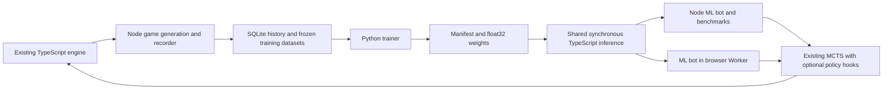

# ML bot: reviewed architecture and implementation plan

Planned/reviewed and first implementation completed 2026-10-21. **Status:
foundation and a small unvalidated pilot implemented.** SQLite capture,
versioned features, frozen datasets, CPU training/export, shared inference,
Worker/UI integration and manual self-play tooling are now usable. See
[BOT_ML_IMPLEMENTATION.md](BOT_ML_IMPLEMENTATION.md) and
[ml/README.md](../ml/README.md) for actual behavior, commands and measurements.
Later phases below remain a research plan, not claims of completed strength
validation. The strategy key is `ml`.

## 1. Review decision

The core direction fits this app: learn position values and eventually move
ordering, retain the authoritative Standard simulator and multiplayer MCTS,
bootstrap from existing bots, and improve against a diverse opponent pool.
There is no evidence yet that one network/search design is optimal. The first
experiment should establish whether learning improves strength within the
browser budget, and which component produces the improvement.

The original plan combined too many research changes before that experiment.
Use the revised phases below: a small synchronous value model first, learned
candidate ordering second, then iterative self-play. Support both seat counts
in the interfaces and tests from the start; use two-player games for the first
training pilot, then explicitly validate three-player play, which remains a
primary product requirement.

| Original choice or omission                                          | Review and implementation decision                                                                                                                                                                                                                                                        |
| -------------------------------------------------------------------- | ----------------------------------------------------------------------------------------------------------------------------------------------------------------------------------------------------------------------------------------------------------------------------------------- |
| ONNX adapters behind existing search hooks                           | A blocking integration issue: ONNX JavaScript `run()` returns a Promise, while every existing search hook and `StandardBot.search()` is synchronous. Start with a small exported MLP evaluated synchronously in TypeScript. Benchmark ONNX later before changing the search architecture. |
| Value model, ranking loss, auxiliary heads and Gumbel search at once | Separate these experiments. Start with outcome regression and the existing candidate/search policy. Add a separate candidate-ranking head only after the value baseline.                                                                                                                  |
| Afterstate values described as policy priors                         | `Candidate.value` and node `prior` currently mean a utility vector over players. They are not probabilities over actions. Retain that meaning; proposal ordering can use those values without changing UCT into PUCT.                                                                     |
| Seat rotation on every position                                      | Correct only with explicit output remapping. After a turn, seat 0 usually belongs to the next player, not the player choosing the candidate. See section 4.                                                                                                                               |
| Final outcome attached to candidate afterstates                      | Valid only for positions actually visited. Unplayed alternatives need search-derived targets or their own continuations, not the outcome of the chosen line.                                                                                                                              |
| Split by game                                                        | Split by setup family, including all seat rotations and repeated games on that setup. Keep a final test set separate from adaptive promotion tests.                                                                                                                                       |
| Plain three-output softmax                                           | Mask the absent third seat before softmax and loss. Padding input features alone does not prevent assigning it value.                                                                                                                                                                     |
| `lastSwap` presence only                                             | Insufficient: include owner, card type and directed transfers, which affect legal reversals. Preserve null last-action information for scoring.                                                                                                                                           |
| Copy an “exact endgame solver”                                       | Informed uses a depth-3 beam over selected actions. Outcomes of examined all-pass lines are exact; the action search is incomplete. Keep this distinction in code and reports.                                                                                                            |
| 20,000 games and a 256-wide residual network up front                | Establish throughput, storage and learning curves with a pilot. Scale when evidence justifies it.                                                                                                                                                                                         |

This is initially **learned value evaluation within max^n MCTS**. Once search
trains candidate preferences and those preferences guide later search, it is
an Expert Iteration style system. It is not a faithful implementation of
AlphaZero or Gumbel AlphaZero, and their guarantees do not automatically apply
to this sampled-action, three-player search.

## 2. Scope and constraints

Read [BOT_RESEARCH.md](BOT_RESEARCH.md),
[BOT_IMPLEMENTATION.md](BOT_IMPLEMENTATION.md),
[PATIENT_BOT.md](PATIENT_BOT.md), [BOT_INFORMED.md](BOT_INFORMED.md),
[ENGINE_API.md](ENGINE_API.md), and the source files named below. The project
rulebook remains authoritative.

- Goal: a fourth Standard strategy that eventually improves on Informed at
  two and three seats under the same browser thinking budget. Report each
  seat count separately; strength is an experimental outcome, not an assumption.
- Preserve Reference, Patient and Informed decisions and default search paths.
  Snapshot and tactical tests must continue passing without updated expectations
  merely to accommodate ML changes.
- Keep Advanced, hidden-information learning, LLM integration and production
  release outside this implementation. The existing research release criterion
  and experimental setup gate remain unchanged.
- Rules stay in `src/game/`. Use `cardChoices`, `sampleCardPlan`, `simulate`
  and the existing effect/summon helpers. Do not implement a Python rules engine.
  Every actual game move still passes `turnEngine.commitTurn`.
- The model and proposal code receive reconstructed Standard states, derived
  from `getObservation` and `witnessedCards` through `reconstructStandard`.
  They must not read the live session, private setup records, real seed or RNG.
  The trusted harness may read events to construct public memory, attach final
  labels and manage experiment seeds. That metadata never becomes model input.
- Fixed-iteration reproducibility requires the same runtime, model, parameters,
  seeds **and prior search/cache history**. Use fresh instances or identical
  full histories in tests. A wall-clock cap cannot guarantee identical plans.
- This document specifies implementation and later experiments. Reviewing or
  editing it alone does not authorize running training jobs. During implementation, report each
  milestone with evidence; follow the user's authorized scope when proceeding.

## 3. Architecture and concrete integration points



### 3.1 Files and responsibilities

| Path                                | Responsibility                                                                     |
| ----------------------------------- | ---------------------------------------------------------------------------------- |
| `src/bot/ml/features.ts`            | Sole feature encoder, normalization and seat permutation contract                  |
| `src/bot/ml/model.ts`               | Validated artifact types, synchronous dense/ReLU inference, masked softmax         |
| `src/bot/ml/mlBot.ts`               | Policy modes, terminal bypass, output remapping, bounded caches and model identity |
| `src/bot/ml/proposals.ts`           | Phase 2 candidate sampling, batched scoring and ordering                           |
| `src/bot/ml/record.ts`              | Runtime-neutral versioned record types; no filesystem imports                      |
| `scripts/ml/`                       | Node recorder, generation/profile entry points, resumable SQLite writer            |
| `scripts/benchmark-bot.mjs`         | Preserve existing results format; add ML factories, models and time budgets        |
| `ml/pyproject.toml`, `ml/README.md` | Pinned training environment and reproducible commands                              |
| `ml/`                               | Dataset validation, training, export and later generation orchestration            |
| `models/`                           | Small checked-in parity fixtures and manifests; selected release metadata          |
| `public/models/<model-id>/`         | One deployed manifest and weight artifact, loaded only for ML                      |
| `artifacts/ml/`                     | Ignored generated datasets, checkpoints and detailed traces                        |
| `docs/benchmarks/`                  | Small committed evaluation JSON and experiment summaries                           |

**Storage decision (user preference): SQLite is the durable source of truth.**
Use [SQLITE_TRAINING.md](SQLITE_TRAINING.md) and its executable migration/query
contracts for raw history, feature caching and frozen datasets. A small Node
repository serves the browser through an API and the benchmark directly.
NDJSON can remain an interchange format, but is not the primary archive.
Implement capture before collecting irreplaceable human games.

### 3.2 First policy: change only leaf evaluation

Export the current private Informed policy factory as
`createInformedPolicy(params)` without changing its implementation or defaults.
The initial `MlBot` can extend `StandardBot` using that policy with only
`evaluateLeaf` overridden. Candidate ordering, rollout evaluation and root
rules remain the Informed control condition. This is an explicit **hybrid**
baseline; measure how often its root rules override the learned preference.

The learned leaf value is:

1. `terminalUtility` immediately if `state.result` exists;
2. otherwise encode, infer, mask absent seats and restore `state.playerOrder`;
3. optionally blend with the original leaf evaluator using a recorded parameter
   `learnedWeight`: `(1 - w) * baseline + w * learned`, with experiments at
   `w = 0`, `0.5`, `1`. The `w = 0` path must return the baseline directly and
   skip inference, so it is a meaningful equivalence check.

Do not silently add another all-pass blend on top of the baseline's existing
blend. Treat pass margins, all-pass preferences and beam search as independent
ablation parameters once the baseline works. The first model need not replace
all heuristic evaluation calls.

### 3.3 Inference contract

```ts
interface EncodedPosition {
  readonly features: Float32Array;
  // Canonical index -> index in this state's playerOrder; -1 means padding.
  readonly canonicalToPlayer: readonly [number, number, number];
  readonly present: readonly [boolean, boolean, boolean];
}

interface ValueModel {
  readonly modelId: string;
  readonly featureVersion: string;
  readonly inputSize: number;
  // Flattened [batch, inputSize] -> logits [batch, 3], synchronously.
  predictBatch(features: Float32Array, batchSize: number): Float32Array;
}
```

Load artifacts asynchronously **before** constructing the ready bot. Inference
inside a search is synchronous. Implement only dense layers, ReLU and the
specified output heads; reject unsupported operations and malformed shapes.
Use float32 weights and buffers and a documented accumulation order. Verify
against Python fixtures with `atol=1e-5`, `rtol=1e-4`; investigate failures
rather than widening tolerances blindly. Near-tied actions need not match
across runtimes even when numerical parity passes.

Start without caching; profile before enabling a bounded LRU (initial cap
4,096 entries). Cache by exact encoded float32 bytes and model hash, verifying
bytes if using a shorter hash. Store canonical logits, not a utility vector
already mapped to some other state's player IDs. Never use a feature-only key
for search-tree reuse. Recreate bot instances on model/policy changes; keep
models immutable during a game.

### 3.4 Why ONNX is deferred

The official [ONNX JavaScript API](https://onnxruntime.ai/docs/api/js/interfaces/InferenceSession.html)
defines `run()` as asynchronous. A Promise cannot be returned from the existing
`evaluate`, `evaluateLeaf` or `propose` hooks. Preloading the model does not
make its inference synchronous.

If profiling later favors ONNX, add an explicit asynchronous search path that
awaits evaluations/expansion, batches independent candidates, checks deadlines
around batches and awaits the Worker result. Preserve the existing synchronous
path and its snapshots. Do not use blocking Promise wrappers. Benchmark the
whole search, including encoding, JS/runtime crossings and batch construction.
Use locally served runtime assets, start WASM with one thread, and only enable
threading after verifying cross-origin isolation and deployment headers; see
[ONNX Web performance guidance](https://onnxruntime.ai/docs/tutorials/web/performance-diagnosis.html).

## 4. Features, perspective and outputs

### 4.1 Perspective contract — required before collecting data

Encode each **nonterminal** state from its own active player's perspective:
rotate the existing clockwise order so that player is canonical seat 0. Preserve
clockwise order; do not sort opponents by cards or score. At two seats, pad
canonical slot 2. Region and faction order are always `REGION_IDS` and `FACTIONS`;
no geography or faction permutation augmentation is assumed valid.

Restore model outputs to the state's original `playerOrder` before returning
from a search hook. To rank a candidate, select the **parent actor's** component
of that restored vector. For example, if A acts and the afterstate's active
player is B, canonical component 0 describes B; A is generally component 1
at two seats or component 2 at three. Use IDs/mappings, never that shortcut.

Store each sample's frame mapping, including afterstates in optional traces.
Rotate its final target using **that sample's frame**, not the root frame or
final game's active player. Terminal candidates bypass inference and use exact
engine utility directly. These are successor positions after full turn
finalization, including card consumption, summon and any struggle.

### 4.2 Initial feature layout: `standard-v1`, 474 floats

Freeze the offsets below in code and export a machine-readable schema for
Python. Python consumes already encoded vectors; it does not reimplement game
features. A schema change requires a new feature version and regenerated data.
All one-hot categories have the explicit order given here.

| Offsets | Group                        | Layout and normalization                                                                                                                                                                                                                                                                                                                                                             |
| ------- | ---------------------------- | ------------------------------------------------------------------------------------------------------------------------------------------------------------------------------------------------------------------------------------------------------------------------------------------------------------------------------------------------------------------------------------ |
| 0–175   | Eight region blocks, 22 each | Followers by faction /18 (3); control `[unresolved, Scottish, Welsh, English, unstable]` (5); faction control's struggle index /8 or 0 (1); current track slot 1–8 one-hot, including face-down cards (8); face-up flag (1); negotiation owner `[none, seat0, seat1, seat2]` (4)                                                                                                     |
| 176–250 | Three seat blocks, 25 each   | Presence (1); court counts /18 (3); hand counts in `STANDARD_CARD_TYPES` order, Assemble /2 and other types /1 (7); total hand /8 (1); negotiation location `[none, ...REGION_IDS]` (9); has-ever-acted flag (1); last action sequence /24 or 0 (1); action age `(actionSequence - lastActionSequence)/24`, or 0 if never acted (1); signed card lead over strongest opponent /8 (1) |
| 251–274 | Global, 24                   | Supply /18 (3); control discs /8 (3); instability discs remaining in France /3 (1); consecutive passes /3 (1); player count `[2,3]` (2); next face-up slot `[none,1,...,8]` (9); starting player in canonical order (3); turn sequence /96 and action sequence /24 (2)                                                                                                               |
| 275–473 | Last swap, 199               | Presence (1); canonical owner (3); type `[manoeuvre,outmanoeuvre]` (2); action age /24 (1); directed transfer counts /3 in `[from region, to region, faction]` order, 8×8×3 (192)                                                                                                                                                                                                    |

Absent seat blocks and absent swap blocks are entirely zero. Aggregate repeated
swap transfers in the same cell, preserving direction; diagonal cells are zero
for valid region swaps. The control one-hot distinguishes unresolved regions
from a faction's encoded struggle index. The existing track slots preserve the
resolved order also for unstable regions.

Use valid engine states and assert finite values/ranges; do not silently clip
out-of-range data. The normalizers follow Standard's 18 followers per faction,
eight cards per player, at most 24 card actions, and the existing three-seat
96-turn bound. Revisit the schema if those rules change.

Names, controller/strategy labels, setup seeds, RNG, event IDs and result labels
are excluded. Discard-top type is redundant for Standard move/scoring semantics
once hand inventory and swap memory are included; public-memory validation
still checks it before reconstruction. This is a feature representation, not a
serialization of `GameState`: test known offsets and rule-relevant distinctions,
not an impossible full-state round trip.

### 4.3 Model and loss

Start with `474 -> 128 ReLU -> 128 ReLU -> 3 logits`: **77,699 parameters**,
310,796 bytes of float32 weights/biases before manifest/container overhead.
Compare a linear value model and, if needed, width 64 before increasing size.
The earlier 256-wide residual proposal is a later measured alternative; its
parameter count depends on how each residual block is defined.

Mask absent-seat logits to negative infinity before stable softmax. Train on
`terminalUtility` targets from the actual completed game, rotated into the
sample frame, with distribution cross-entropy:

`L_value = -sum(target[i] * logSoftmax(maskedLogits)[i])` over present seats.

Zero padding must receive zero probability and contribute no loss. Draws
share one point among contenders, and non-contenders get zero. Interpret the
output as expected score under the training mixture; it is not a certified
probability of winning under optimal play. Never renormalize existing heuristic
utility vectors as though they were policy probabilities.

Initial reproducible training defaults: AdamW, learning rate `1e-3`, weight
decay `1e-4`, batch size 256, maximum 30 epochs, early stopping after five epochs
without improvement in validation value loss. Save optimizer state, training
seed, best checkpoint and all resolved settings. These are starting parameters,
not claimed optimal values. Validate outcome loss/Brier score by seat count,
game stage and opponent mix; strength is decided by games.

### 4.4 Later heads — each requires an ablation

Do not add auxiliary or ranking losses to the first model. Later candidates:

| Head                 | Correct target and caveat                                                                                                                                                                           |
| -------------------- | --------------------------------------------------------------------------------------------------------------------------------------------------------------------------------------------------- |
| Candidate preference | Separate rank logits over player perspectives, read for the parent actor on each candidate afterstate; softmax across the recorded candidate set. Keep this distinct from calibrated value outputs. |
| Final region control | Five classes including **unresolved**, because an Invasion can end with regions unresolved                                                                                                          |
| Ending               | Invasion/Coronation from the completed game                                                                                                                                                         |
| Faction order        | Soft target uniform over all orderings allowed by `enumerateFactionRankings`; mask out Invasion cases initially. Never invent a unique ranking where the engine allows several.                     |
| All-pass value       | Exact conditional result from `passingResult` on that particular state; distinct from actual outcome and never evidence that an opponent must pass                                                  |

Start an auxiliary ablation with loss weight 0.1 relative to value loss and
record any changes. Export only the trunk and heads used at play time: merely
ignoring an exported output does not guarantee zero computation cost.

## 5. Search and candidate ordering: Phase 2 specification

An action is a complete legal `TurnPlan`, including pass. The large branching
factor supports sampling candidates, but the original estimate of roughly
18,000 opening turns is position-specific and not a universal bound. Record
actual counts and profile representative openings, midgames and endings.

### 5.1 Bounded candidate generation

Begin with a deliberately measurable proposal policy:

1. Always include pass and fully simulate it.
2. Use `cardChoices` and `sampleCardPlan` to sample up to 8 distinct complete
   turns per card type at the root, 2 inside the tree. Deduplicate exact plan
   keys and cap attempts at four times the requested count per card type.
   With seven types this proposes at most 57 / 15 turns including pass.
3. Batch-encode nonterminal successors, infer once, restore output frames and
   rank by the parent actor's value (later the independent rank head).
4. Return pass first, then ranked cards with stable plan-key tie breaking. Retain
   the existing proposal queue's exploration and fallback sampling. Log the
   actual considered set; it is not an exhaustive action policy.
5. Compare this with Informed's effect/summon prescreening. If reusing its
   private `rankSummons`, extract/export it without changing behavior and keep
   uniform legal sampling in the mixture so the heuristic cannot exclude every
   unconventional move. Increase proposal budgets only after profiling.

This first ordering experiment learns ranking through values, without an
imitation loss. Enable learned `evaluate` separately from learned `evaluateLeaf`;
otherwise replacing evaluation also changes rollout behavior and candidate
priors, obscuring the source of any improvement. If necessary add a separate
rollout-evaluator option whose default is the existing evaluator. Cover each
option with a control run.

The current search checks its time cap between iterations, so it is a soft
target. New ML proposal and beam helpers must accept a per-request deadline,
check it between bounded batches and retain a legal best-so-far plan (pass is
available initially). An ML-specific wrapper can initialize this context before
calling `super.search`; it must not alter fixed-iteration behavior when no time
cap is supplied. Report overshoot instead of claiming a hard 1,400 ms limit.

### 5.2 Root decisions and exactness

Immediate terminal outcomes always use engine utility. If passing immediately
ends in a loss and some card action is available, the ML root policy may prefer
an intervention, but that does not establish that the intervention wins.
Preserve the existing immediate-win precedence.

Treat Informed's `passWhenWinning` and margin as tunable heuristics. An all-pass
win while opponents hold cards is conditional. Once opponents are spent, an
examined sequence followed by passes has an exact outcome, but a beam search
can miss a winning sequence. If sharing that helper, retain depth 3 / beam
width 6 as recorded baseline parameters and include its work in the thinking
budget. Do not label it an exhaustive solver.

### 5.3 Optional imitation and search changes

Add candidate ranking loss only if value-based ordering is insufficient.
For an eligible root trace, form a visit target over expanded candidates using
fresh visits from this search, with temperature 1 initially. Disable tree reuse
for these training searches, or record visit deltas rather than counting prior
search work again. Skip ranking loss when there are no meaningful visits.

Do not mix teacher final-choice labels with visit targets indiscriminately:
Patient/Informed root overrides can select a low-visit action, or a beam-search
plan outside the tree. Record `selectionReason`; initially exclude root-rule,
beam, random-opening and noise-overridden decisions from ranking supervision.
They remain valid sources of realized-state value data. Any later imitation of
root-rule choices is a separate labeled experiment.

A candidate preference head learns only within sampled sets. There is no claim
that absent actions were bad. Terminal candidates keep exact values for search;
initial ranking supervision may skip roots containing them to avoid encoding
terminal states solely for this auxiliary task.

**Defer Gumbel/sequential halving and PUCT.** Gumbel planning requires defined
action logits, a root action set, allocation and completed-value rules. Adding
noise to current utility priors is not that algorithm. After a working policy
head, specify and benchmark a separate optional selector against unchanged UCT;
do not make it a prerequisite for data collection.

## 6. Data, trace and artifact contracts

### 6.1 Recording without altering teachers

The current `SearchResult` exposes only the chosen plan and aggregate stats.
Add an optional post-search trace observer as an instance option, disabled by
default. It observes immutable copies of expanded root choices and the selected
plan; it must not consume RNG, change candidate order or mutate/reuse nodes.
Create the trace after the timed search and report serialization separately.
Fixed-iteration teacher plans/stats must match with recording on and off.

Expose root visits, utility means, utility priors, frame mappings and final
selection reason. If the selected plan was produced outside the tree, append
it with zero visits and an explicit flag. Do not pretend these are all
candidates considered during internal proposal generation. Log proposal counts
separately. Record finite values only.

### 6.2 Versioned record and SQLite contract

Persist typed accepted history and outcomes transactionally in SQLite. Build
versioned pre-turn feature rows offline and materialize/freeze dataset membership
using the tables in [SQLITE_TRAINING.md](SQLITE_TRAINING.md). Resume generation
by immutable run configuration and completed game IDs; interrupted games remain
incomplete and are excluded from realized-outcome training. The logical records
below describe required fields; their SQL mapping is defined in that contract.
Optional external trace/shard exports use temporary files and atomic publication,
not repeated rewriting of the entire game history.

| Record              | Required fields                                                                                                                                                                                                                                                    |
| ------------------- | ------------------------------------------------------------------------------------------------------------------------------------------------------------------------------------------------------------------------------------------------------------------ |
| Run manifest        | `schemaVersion`, rules/feature/algorithm versions, code revision, resolved bot parameters, per-seat policy/model IDs, search budgets, all RNG stream seeds, setup-family IDs, dataset split, concurrency, runtime and artifact hashes                              |
| Decision            | `gameId`, setup-family ID, turn, seat count, actor index, frame map, float32 features, chosen full typed plan, policy/model ID, search stats, behavior flags and optional trace reference                                                                          |
| Root trace (opt-in) | Root public observation + witnessed memory for replay, candidate full plans/stable IDs, nonterminal afterstate features and frames, exact terminal utilities where applicable, visits/deltas, means, utility priors, selection reason, candidate-generator version |
| Outcome             | `gameId`, completed flag, terminal utility in original seat order, ending, final controls and scoring details needed for auxiliary labels                                                                                                                          |

Use full typed plans initially, rather than lossy display summaries: effect
kind and target regions alone cannot reconstruct ordered transfers, counts,
negotiation operations or zero summons. Compress instead. Build canonical keys
with the existing stable operation order; do not merge distinct anti-undo states.
The browser's public display archive is not a training-record format.

Also write one **game-start record** with `gameId`, original seat order,
per-seat policy/model assignments, setup-family ID and the initial active
seat's public observation plus witnessed memory. The trusted manifest may
retain the actual setup seed for reproduction; it is never fed to the model.
This record plus accepted typed plans enables replay and label auditing even
when root traces are disabled. Generate decision features again during replay
and compare them with recorded vectors.

**Critical labeling rule:** the actual final outcome labels visited decision
states and, if separately recorded, the chosen successor. It must never label
unplayed candidate successors. Search means are optional approximate targets
with separate provenance, not realized outcomes. Avoid double-counting a chosen
successor that also appears as the next recorded decision state.

For value-only runs, omit candidate traces. When ranking experiments begin,
record at most 64 root candidates and sample traced decisions with an independent
RNG stream; always include the chosen action and pass, then prioritize visited
actions. Renormalize targets over the retained set and record truncation.
Set trace rate explicitly (pilot default 10%) and measure bytes per game.

### 6.3 Splits and diversity

Use deterministic setup-family splits, initially 80/10/10 for train/validation/
internal test. A family includes all seat rotations, repeated policy matchups,
noise variants and continuations of the same setup. Deduplicate equivalent
starting public positions into one family. Namespace seeds and record a split
manifest; never split rows randomly. Keep external benchmark seeds separate.

Pilot two-seat data: balanced teacher matchups including self-play, both seat
rotations, 5% random action replacement, plus a small declared fraction of
random-seat games. Random opening lengths can be drawn from 0–3 with a recorded
stream. Noise and opening overrides are marked; their search traces are not
ranking labels. Include both winning and losing perspectives, not winners only.

For the three-seat expansion include homogeneous and mixed opponents, and
rotate all policy assignments around each board. Balance training batches by
seat count and game stage, using game sampling before state sampling so longer
games do not dominate solely because they contain more rows. Begin with 50/50
two-/three-seat batch allocation, report both losses, and compare separate
models if a shared model shows negative transfer. Excluding policy IDs from
features means values average over the declared opponent mixture; document it.

Use separate deterministic RNG streams for setup, search, exploration, pool
sampling, trace sampling and training. Turning recording on must not change
moves. Resume must preserve assignment/seed maps and avoid duplicate games.

### 6.4 Manifest and deployment

Every model manifest contains: artifact format version, model ID, rules and
feature versions/schema hash, input/output layout, supported seat counts,
layer shapes/activations, weight dtype/byte order/offsets, weights SHA-256,
training run/data/split hashes, code revision, hyperparameters, policy mode and
resolved parameters, validation metrics and evaluation report references.

Use row-major dense weights `[out, in]`, float32 little-endian binary, followed
by each layer's bias in declared offset order. Verify dimensions, lengths,
finite weights, version support and hash before use. Export small Python input/
logit fixtures alongside each candidate artifact for TypeScript parity checks.
Do not execute arbitrary graphs or code from a manifest.

Keep generated databases/shards, optimizer checkpoints and temporary models out of git.
Commit small parity fixtures, manifests and evaluation summaries; deploy only
the selected immutable browser artifact. Use one source of truth for its model
ID instead of manually maintaining duplicate files in `models/` and `public/`.

### 6.5 Human games: collect early, train selectively

Save replayable Standard games involving humans, including losses, draws and
mixed human/bot games. They can expose positions and tactics absent from the
teacher/self-play mixture. Collection and training eligibility are separate:
keep incomplete games for analysis, but require validated completion before
assigning realized terminal utility. Closing the tab or starting another game
does not imply a loss, draw or resignation.

**Current implementation is not sufficient for direct training.**
`App.tsx` calls `archiveSnapshot`/`saveArchive` at setup and accepted commits.
`gameArchive.ts` persists `GameLogEntry` display projections in localStorage,
including formatted headings/details and some follower tables. The live
`GameSession.events` contains typed `TurnCommitted.plan` values and a typed
result, but the archive does not retain these or a versioned replay contract.
There is no central collection endpoint. The SQLite document is a proposal,
not an installed backend. Retain old archives for analysis; any legacy importer
must replay and validate recovered games and reject ambiguous records rather
than guess from display text. A finished seed alone does not recover the moves.

Implement a browser adapter for the same game-start/decision/outcome schema:

1. At setup, persist the public initial Standard position, immutable seat IDs,
   seat controllers, bot algorithm/model/config versions where known, rules
   and record versions, game ID and `source: "human-play"`. Remap display names
   consistently to seat IDs in training exports, including plans/card IDs.
   Source/controller metadata describes the data; it is not a feature input.
2. After each successful human or bot commit, extract the new typed accepted
   events from the session by event cursor and persist their complete turn
   plans. Include passes. Use the shared app commit notification, not draft or
   preview callbacks. The private SQLite history can retain `GameCreated` for
   replay; training records use the public game-start projection and exclude
   private setup fields.
3. Persist the final structured `GameResult` and completion status together
   with the final event batch. Preserve incomplete/abandoned status separately.
   Recording all moves in a human game lets training use visited positions on
   both human and bot turns, not just the human decisions.
4. Send accepted commands through the same-origin Node API into SQLite using
   event cursors, idempotency keys and the transaction protocol in
   [SQLITE_TRAINING.md](SQLITE_TRAINING.md). Expose save acknowledgment/failure;
   a React update alone does not establish durable persistence. An offline
   outbox is optional delivery infrastructure, not the primary archive.
5. Add validated game import/export and portable training-only SQLite exports.
   Deduplicate trajectories, verify replay and final scoring, and materialize
   the same feature/outcome rows as generated games. Feature extraction can
   happen later and be repeated after an encoder version changes.

Suggested boundaries: pure public training projection in
`src/app/trainingArchive.ts`, a Node SQLite repository/API outside `src/game/`,
and `scripts/ml/import-human-games.mjs` for validated import. Use the existing
accepted-commit path for both controllers. Browser collection does not require
a model, background search on human turns or candidate traces.

The private source database may retain full accepted setup/checkpoints for
replay under the storage proposal. Training projection still uses only public
Standard observations/memory; training exports omit names and setup secrets.
Use explicit export/upload flows when moving games between independent installs.
The preferred local Node service owns one SQLite file; multiple browsers use its
API rather than directly opening the file. See the storage contract for browser-
only SQLite alternatives if that deployment constraint becomes necessary.

Training policy for this source:

- Value learning: use validated completed trajectories and their actual final
  utility, including games the bot lost. A win does not prove every move on
  that trajectory was good; labels describe the realized continuation.
- Policy learning: human moves are not automatically expert targets. Initially
  omit them from imitation/ranking loss. Later reanalyze sampled human positions
  with a frozen stronger search, including the observed human move in the legal
  candidate set. Record new visit/value targets, search budget and model ID
  separately from the original behavior and outcome. A search target remains
  approximate, and unplayed candidates never inherit the human game's result.
- Mixture: begin with a declared 10% human-game share of training samples as an
  experiment; compare 0%, 10% and 20% on development data if enough games exist.
  Do not repeatedly oversample a handful of games to satisfy that share. Sample
  games before positions and monitor source-specific losses and anchor matches.
  These percentages are starting hypotheses, not established optimal weights.
- Splits: apply setup-family grouping and trajectory deduplication across
  generated/imported data. Keep a human test set out of training and reanalysis.
  Where participant identity is explicitly available, add a player-disjoint
  assessment; otherwise use collection-session/time groups and state that new-
  player generalization was not measured. Display names are not reliable IDs.
- Updates: import, train and evaluate versioned checkpoints offline. Loading a
  new model after a controlled evaluation is separate from saving a game; do
  not update model weights automatically after every human match. Historical
  replay prediction scores do not measure how a new bot would play against
  humans; that requires fresh matches with the frozen candidate.

Learning from a fixed behavior dataset can encounter distribution shift; the
[CQL paper](https://arxiv.org/abs/2006.04779) documents this problem in offline RL.
That motivates controlled mixing and evaluation here, not a requirement to add
CQL to this outcome-regression pipeline.

Browser adapter acceptance tests: a mixed human/bot Standard game survives
storage/export/import with identical accepted moves and final utility; drafts
are absent; duplicate callbacks do not duplicate events; failed/interrupted
writes are detected; incomplete games receive no fabricated result; names and
private setup fields are absent from training exports. Use the same replay
validator and feature encoder as generated data. Prioritize this adapter after
the Phase 0A record schema is stable, before large training runs or human tests.

## 7. Worker lifecycle and benchmark support

### 7.1 Browser loading

Add an explicit ML preparation handshake to `BotClient`/Worker. Lazy-load model
code and same-origin weights only when an ML seat is needed, show “Loading bot”,
and report readiness before starting a search request. Use a separate bounded
load timeout (initially 15 seconds, cancellation available); do not charge a
cold model download to the existing 2,500 ms search watchdog. Warm searches
retain the 1,400 ms target and 2,500 ms watchdog.

Preparation and search messages need request IDs, error replies, stale-response
checks and termination on cancellation. A Worker has one outstanding operation;
cache a successful load for later ML turns. A failed/corrupt/missing artifact
shows retry, not silent substitution of Informed. Retry creates a clean loading
attempt. Model changes require a fresh bot/tree and cleared inference cache.

Add `ml` to `BOT_STRATEGIES`, UI setup, `BOT_STRATEGY_LABELS`, Worker routing
and archive compatibility tests. Existing validation derives from the strategy
list; do not introduce rule changes. Keep the experimental gate. Random model
weights are internal smoke-test artifacts, not the default selectable opponent.
An untrained three-seat model must not be advertised as validated for that mode.

Persist the actual model ID and algorithm version as optional app/archive
metadata, with legacy-read compatibility; no tensor weights or private state in
public logs. The strategy name alone cannot identify a learned opponent.

### 7.2 Harness extensions

Add these options incrementally, rejecting unsupported or contradictory ones:

- `--bot=ml --model=<manifest>` and `--opponentModel=<manifest>` for ML opponents;
- `--mlMode=leaf|value-order|rank-order`, with recorded resolved parameters;
- `--record=<dir> --traceRate=0 --noise=0 --openings=random:0`;
- `--timeMs=1400 --opponentTimeMs=1400` with iteration ceilings, in addition to
  existing fixed-iteration runs;
- later `--opponent=pool --pool=<json>` with explicit per-seat assignments.

The current runner shares a bot object by strategy. Change the controller
factory for ML so candidate and champion can use **different immutable models
in the same game**. Keep separate instances per seat/model/config and reset
between games. Preserve non-ML baseline behavior. Warm both models before timed
evaluation, report loading separately, and include all inference/root solving
in decision time.

Keep the existing JSON result envelope and bootstrap implementation; add model
metadata, actual opponent assignments, stage timings, inference counts, cache
hits, proposal counts, retained cards at first struggle and override frequencies.
Stream progress to stderr, final benchmark JSON to stdout, records to files.

## 8. Revised phases and exit criteria

### Phase 0A: encoder, recorder and inexpensive baseline

Implement sections 4.1–4.2 and 6, plus the optional root trace observer. Start
with value rows only. Deliver SQLite records for 20–50 completed pilot games at both seat counts,
a dataset validator, deterministic splits and a simple constant/linear outcome
baseline. Measure generation time and bytes per game before allocating a large
run. No UI integration or search replacement is needed yet.

Exit: seed-family separation, legal replay, known feature offsets, absent-seat
mask, perspective mapping and observer neutrality tests pass. A deliberately
small dataset can be overfit by the training code, confirming the pipeline;
this is not a strength result.

### Phase 0B: inference and experimental integration

Train/export the small MLP or use a deterministic random fixture internally.
Implement synchronous inference and Python parity tests, the leaf-only policy,
ML harness factories, and Worker preparation/error behavior. Support both seat
counts in code and smoke tests. Add the experimental UI entry only with a
valid deployed artifact and honest supported-mode metadata.

Exit: seeded games terminate within the engine bound, every move validates,
existing bots remain identical, model failures/cancellation are covered, and a
browser all-bot smoke game succeeds. Profile batches 1, 16, 64 and 512, cold
load, full-search p50/p95/max, peak memory and model download size. A synchronous
batch loop is not assumed to offer native matrix batching speedups.

### Phase 1: learned-value usefulness

Generate an initial **1,000–2,000 two-seat games**, then expand to three-seat
and mixed matchups. This is a planning range, not a sufficiency claim. Increase
data in stages if held-out learning curves improve; 20,000 games is an optional
later scale, not the first gate. Train at least the linear and small MLP models.

Compare Informed, the exact `w=0` hybrid control, and learned-weight ablations.
Report held-out prediction loss and full-game outcomes. At minimum use 100 games
/50 setup seeds for two seats and 60 games/20 seeds for three, with rotations.
Report versus Patient and Informed separately. Continue development if the
pipeline works but strength does not improve; diagnose coverage, model error
and search cost rather than claiming the phase established superiority.

Evidence to proceed to larger learning experiments: validated inference/data,
acceptable latency, and a reproducible signal of usefulness (better prediction
than the simple baseline plus competitive game performance, or a statistically
supported game improvement). If neither appears, investigate before scaling.

### Phase 2: learned ordering and multi-player validation

Implement bounded value-based proposals and compare leaf-only versus value-order
at equal elapsed time. Add a separate ranking head only if those experiments
justify it, then test the ranking loss separately. Add auxiliary heads one at a
time. Do not combine a larger model, different root rules and new tree selection
in a single unidentifiable comparison.

Deliver a validated three-seat model or a declared separate checkpoint for that
mode. Test one ML against two fixed opponents, two ML against one fixed opponent,
and mixed Patient/Informed seats. A win against two identical opponents alone
does not establish robustness to all multiplayer lineups.

### Phase 3: iterative self-play and opponent pool

Use immutable generations: generate with a frozen champion/pool, validate data,
train, export, then evaluate a candidate. Resume from a generation manifest.
Keep a replay window of the last five generations initially plus a 20% sample
of bootstrap/anchor data; record age and sampling weights.

Initial pool per opponent seat: 40% current champion, 30% recent prior
checkpoints, 30% fixed teachers (10% each). Before older checkpoints exist,
allocate their share to the champion. Keep at least 20% fixed teachers in later
tuning. Include explicit all-current-model self-play games. This reduces
forgetting risk; it does not guarantee non-regression. Start with a uniform
checkpoint reservoir; prioritize opponents only once matchup estimates have
adequate sample sizes and the weighting rule is documented.

Begin with existing fixed search budgets and small recorded action exploration.
Only later test playout-cap randomization (for example 75% of decisions at 32
iterations and 25% at 128); use high-budget, non-overridden traces for ranking
and all completed visited states for outcome targets. Temperature/noise must
act on a defined candidate distribution. Record seeds and behavior probabilities
where available. Gumbel/Dirichlet experiments remain optional.

Promotion uses fresh evaluation seeds and the same decision-time budget:

| Check                                   | Initial decision rule                                                                                                                       |
| --------------------------------------- | ------------------------------------------------------------------------------------------------------------------------------------------- |
| Candidate vs champion, two seats        | At least 100 games/50 seeds, 95% seed-cluster score interval lower bound above 50%                                                          |
| Candidate vs two champions, three seats | At least 60 games/20 seeds, lower bound above 33.3%; also report the reverse population mix                                                 |
| Fixed anchors, each seat count          | Paired candidate/champion comparisons on identical seeds; lower bound of score difference above -0.03, a predeclared non-inferiority margin |
| Correctness and tactics                 | Required tests pass; investigate discovered regressions before promotion                                                                    |
| Browser cost                            | Same time cap, no watchdog failures in the declared test set, timing distribution reported                                                  |

These sample counts are starting minima, not a guarantee of adequate power.
Predeclare larger batches if needed; do not repeatedly peek and stop the first
time an interval passes. Separate two-/three-seat champions are permissible
when one model regresses in the other mode. Do not change the release criterion
based on promotion results. After three failed generations, report the plateau
and diagnose it; do not automatically lower thresholds or launch unbounded runs.
An inconclusive interval keeps the incumbent; it is not evidence of equivalence.

### Phase 4: browser hardening and human evaluation

Test on a slower target browser/device, measure model preparation and warm
search separately, and gather human games. Convert reproducible disagreements
into fixtures, using exhaustive analysis only where tractable. Study three-seat
kingmaking with a defined sample/metric instead of treating it as a single win
rate. Advanced mode requires a separate observation/belief design and stays out
of this plan.

## 9. Evaluation, testing and reporting

Use existing seed-cluster bootstrap scores: win 1, loss 0, draw shared among
contenders. Never combine two- and three-seat scores. Fixed-iteration results
isolate algorithm behavior; the main product comparison is the same wall-clock
budget with the same iteration ceiling and device. Raising opponent iterations
to approximate CPU time is supplementary, not a replacement for timed matches.

Use `ml-boot-*`/`ml-gen-*` for generation, `ml-tune-*` for tuning,
`ml-promote-*` for adaptive promotion, and `ml-final-*` for a locked final audit.
Promotion seeds become development evidence after use. Run the final audit once
on the frozen selected model; if its results guide changes, allocate a new final
set. Keep existing benchmark seeds as regression checks, not fresh ML evidence.

Required implementation tests:

- Fixed feature offsets and normalization; distinct swap directions/owners;
  never-acted versus acted; negotiation ordering; two- and three-seat padding.
- Rename player IDs without changing encoded features, and verify canonical
  permutation/output restoration. Specifically test parent-actor values after
  an action changes the active player, and terminal candidates after a struggle.
- No seed/RNG/private setup fields in inputs. Repeat the current inaccessible-
  setup-secret test. Do not corrupt legitimate Standard hands and call that a
  privacy test: they are reconstructible public information.
- Masked softmax sums to one over present seats; absent-seat value is exactly
  zero; finite output; exact terminal win/draw/loss bypass.
- Python/TypeScript golden inference, malformed artifact rejection, cache
  frame correctness and model invalidation.
- No outcome labels on counterfactual candidates; no setup family across splits;
  complete-game joins; deterministic ingestion resume and teacher-recording neutrality.
- Public commit legality and finite game bound; tactical pass/instability and
  spent-opponent fixtures; model loading, cancellation, stale replies and retry.
- Existing Reference snapshots and Patient/Informed tactical tests unchanged.

At implementation milestone reports run `npm run typecheck`, `npm run lint`,
`npm run test:run`, `npm run format:check`, `npm run build`, and the Python tests
introduced by the training work. Report PASS/FAIL/NOT VERIFIED accurately.
Documentation-only revisions need formatting/link checks, not a new strength
benchmark. Keep measured results in separate experiment reports linked here.

## 10. Dependencies and compute budget

| Dependency                              | Initial decision                                                                    |
| --------------------------------------- | ----------------------------------------------------------------------------------- |
| PyTorch, NumPy                          | Pin in a separate `ml/` environment for training/export; no browser import          |
| Node/browser inference packages         | None for the initial dense/ReLU runtime                                             |
| ONNX, onnxruntime-node, onnxruntime-web | Deferred until measured need justifies the asynchronous integration and bundle cost |
| Python test tooling                     | Justify and pin if added; standard-library unittest is sufficient initially         |

Record exact resolved versions and reproducible install commands when
implementing. Avoid choosing versions from memory. Training and generation must
not make runtime network calls; browser assets remain same-origin.

The original document's 5,800 random turns/s and roughly 0.2 seconds per Informed
decision are prior observations/estimates, **not remeasured by this review**.
Random simulation throughput does not predict neural MCTS throughput. At 33
turns and 0.2 seconds each, 20,000 games would consume about 36.7 CPU-hours before
recording and training, or about 3.7 hours on ten perfectly scaling workers.
Actual quotas, contention, longer three-player games and inference overhead can
make this substantially slower. “Half a day” is not an established budget.

Profile 100 games at 1, 2 and 4 workers before increasing concurrency. Start
PyTorch/BLAS thread counts at one per generation worker and allocate training
threads separately to avoid oversubscription. Report actual CPU quota, memory,
model batch latency and dataset throughput; do not change the frozen teacher
proposal budgets to accelerate generation without recording a new teacher version.

At 474 float32 features, one million state vectors alone occupy about 1.90 GB
before labels or container overhead. Sixty-four candidate vectors per decision
would multiply that by 64; JSON is larger before compression. Use state-only
recording first, bounded opt-in traces, streaming/chunked Python loading and
measured disk estimates. A GPU is optional for the pilot; CPU training duration
must be measured before promising epoch times or running large jobs.

## 11. Implementation handoff

The initial feature/recording slice, synchronous model runtime, SQLite API,
trainer, export/parity tooling and experimental UI integration are implemented.
Use [BOT_ML_IMPLEMENTATION.md](BOT_ML_IMPLEMENTATION.md) for evidence and actual
remaining limitations, and [ml/README.md](../ml/README.md) for runnable commands.
Do not repeat the old Phase 0A task list or treat a random model as the pilot:
the bundled pilot was trained on validated teacher trajectories.

The next development slice should compare linear and small MLP values on a
larger, independently grouped dataset and run equal-time anchor matches. The
linear model's better validation loss on the first pilot is evidence to keep
that comparison, rather than increasing MLP size by assumption. Add global
final-test exclusions and explicit source/seat sampling before large adaptive
training/promotion runs. Learned proposal ordering, automated opponent pools
and promotion remain separate later experiments.

Human games can already be collected before those phases: capture exact
accepted moves to SQLite now, materialize completed trajectories later, and
keep evaluation games separate. Future execution follows the user's authorized
scope and recorded phase evidence; routine implementation choices do not need
an artificial approval prompt.

## 12. References and their relevance

- Anthony, Tian & Barber, [Thinking Fast and Slow with Deep Learning and Tree Search](https://arxiv.org/abs/1705.08439), 2017: search/generalization iteration; does not establish that this game's learned value baseline will improve.
- Petosa & Balch, [Multiplayer AlphaZero](https://arxiv.org/abs/1910.13012), 2019: evidence from two simple three-player games that motivates multiplayer learning experiments, not a result for this game's incentives or kingmaking.
- Driss et al., [Deep Reinforcement Learning for 5×5 Multiplayer Go](https://arxiv.org/abs/2405.14265), conference 2023 / arXiv 2024: further multiplayer search/learning evidence; retain separate evaluation for this game's three-seat lineups.
- Hubert et al., [Learning and Planning in Complex Action Spaces](https://proceedings.mlr.press/v139/hubert21a.html), 2021: learning with sampled action sets; supports treating candidate coverage and policy targets explicitly.
- Danihelka et al., [Policy Improvement by Planning with Gumbel](https://openreview.net/pdf?id=bERaNdoegnO), 2022: later root-selector experiment with actual policy logits and specified sampling/allocation.
- Wu, [Accelerating Self-Play Learning in Go](https://arxiv.org/abs/1902.10565), 2019: motivation for later auxiliary-target and self-play-efficiency ablations, not proof of benefit for this board game.
- [ONNX Runtime JavaScript InferenceSession API](https://onnxruntime.ai/docs/api/js/interfaces/InferenceSession.html): asynchronous inference contract.
- [ONNX Runtime Web performance diagnosis](https://onnxruntime.ai/docs/tutorials/web/performance-diagnosis.html): execution-provider and threading constraints for a later runtime experiment.
- [OpenSpiel AlphaZero documentation](https://openspiel.readthedocs.io/en/stable/alpha_zero.html): conceptual actor/learner/evaluator separation; the linked page largely describes an older implementation, not a ready-made integration for this repo.

The references motivate experiments. All claims about strength, latency or
compute for this implementation require local measurements and saved artifacts.
