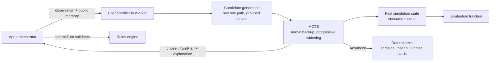

# Algorithmic opponent: research and high-level design

Researched 2026-10-19 for Milestone 6. This document records what the game-AI
literature says about games like this one, what the engine measurements imply,
and the recommended architecture for a bot that is a worthy opponent. The
earlier [move-generation probe](BOT_DESIGN.md) remains the record of the first
branching measurements; this document supersedes its recommendation section.

Nothing here is a new game rule. The bot chooses among engine-generated legal
turns and submits them through the normal commit boundary.

## 1. Summary

Build a **Monte Carlo Tree Search (MCTS) opponent with a hand-written
evaluation function**, evaluation first and search second. Use **max^n backup**
(one utility per seat) because the game has two or three independent players.
Handle Advanced mode's hidden Cunning cards by **determinization** (sampling
plausible deals), upgrading to Information Set MCTS only if measurements show a
need. Keep learning (self-play tuning, later a learned evaluation) as an
upgrade inside the same search, not as the first bot.

No published bot for _The King Is Dead_ or _König von Siam_ was found in this
search. This is a search result, not proof that none exists.

## 2. What kind of game this is, for AI purposes

| Property           | Value                                                                       | Consequence                                                          |
| ------------------ | --------------------------------------------------------------------------- | -------------------------------------------------------------------- |
| Players            | 2–3, each for themselves                                                    | Multiplayer search (max^n), not two-player minimax                   |
| Randomness         | None after setup                                                            | Pure search; no chance nodes                                         |
| Hidden information | Standard: none, given a memory of public plays. Advanced: ≤3 cards/opponent | Standard is perfect information; Advanced needs sampling             |
| Horizon            | ≤8 own actions; ≤`n × (8n + 8)` turns (48 at 2 players, 96 at 3)            | Terminal reach is a hypothesis to measure, not implied by this bound |
| Branching          | ~24k–30k complete turns in sampled openings; 512 Assemble effects alone     | Moves must be grouped or widened progressively                       |
| Scoring            | Exact tiebreaks including timing; draws are valid results                   | Terminal utility must come from the engine's scorer                  |
| Time per move      | Human hotseat; 1–2 s of visible thinking is acceptable                      | Budget of a few thousand simulations per move, in a Worker           |

**Standard is perfect information.** Every player holds the same eight cards
and each play is public when it happens. A bot that remembers witnessed plays
knows each opponent's exact remaining hand. The observation API hides buried
discards from a viewer who was not present; the bot therefore needs a
legitimate **public memory of witnessed events**, not access to the internal
log.

**Many moves are similar, but similarity is not equivalence.** The two identical
Assemble copies can be grouped. Different placements can change a plurality,
the next struggle or the mandatory summon. Preserve these distinct choices
through progressive widening and random exploration; do not discard them as
duplicates merely because their effects look similar.

### Engine measurements (Node container, 2026-10-19)

| Operation                                              | Cost     |
| ------------------------------------------------------ | -------- |
| `assertGameInvariants(state)`                          | 0.025 ms |
| `freezeSnapshot(copyChoice(state))`                    | 0.026 ms |
| Raw `STANDARD_EFFECTS.assemble.enumerate` (512 plans)  | 0.025 ms |
| Raw `STANDARD_EFFECTS.manoeuvre.enumerate`             | 0.042 ms |
| Public `turnEngine.enumerateEffectPlans` (Assemble)    | 1.41 ms  |
| Raw `applyEffectOperations` + `enumerateSummonChoices` | 0.003 ms |
| Random full game through the public API (3 players)    | ~27 ms   |

The public API re-validates, deep-copies and freezes on every call, so random
playouts run at about 37 games/s (57.7 turns/game with a one-third pass
probability). The raw rule functions are roughly an order of magnitude faster.
MCTS needs thousands of simulations per move, so a **fast simulation path** is
the gating engineering item (section 5.1).

## 3. Approaches and what the literature says

### 3.1 Rule-based heuristics

Hand-written rules are cheap and explainable but have a low ceiling: in Scopone
an ISMCTS player beat the best hand-coded expert strategies
([Scopone](https://arxiv.org/abs/1807.06813)). However, the Catan literature is
consistent that search and learning both failed without a strong hand-coded
strategy underneath: MCTS and RL "succeed only when they use substantial prior
symbolic heuristics" ([Guhe & Lascarides 2014](https://homepages.inf.ed.ac.uk/alex/papers/cig2014_gs.pdf),
reviewing [Szita, Chaslot & Spronck 2010](https://link.springer.com/chapter/10.1007/978-3-642-12993-3_3)).
**Conclusion:** write the heuristic anyway, as the evaluation function, playout
policy and move-ordering prior.

### 3.2 Tree search in multiplayer games

With three players the two-player minimax assumption breaks. The candidates are
**max^n** (each player maximizes their own utility), **paranoid** (everyone
opposes the bot) and **Best-Reply Search**. The cited experiments found strong results for BRS among minimax-style
searches and for **max^n-style utility vectors in MCTS** in their tested domains ([Nijssen & Winands, overview](https://dke.maastrichtuniversity.nl/pim.nijssen/pub/cgw.pdf);
[Search Policies in Multi-Player Games](https://dke.maastrichtuniversity.nl/m.winands/documents/policies.pdf);
[Schadd & Winands, BRS](https://dke.maastrichtuniversity.nl/m.winands/documents/BestReplySearch.pdf);
[Sturtevant, UCT in multi-player games](https://webdocs.cs.ualberta.ca/~nathanst/papers/multi-player_UCT.pdf)).
Kingmaking (a losing seat deciding who wins) is inherent to three-player games;
a utility vector models independent preferences but does not solve kingmaking.
**Conclusion:** begin with MCTS and one utility per seat, then measure it here.
In this implementation, backup averages sampled utility vectors; each node's
acting seat maximizes its own UCT value. This is not exact max^n minimax backup
and is not a finite-budget equilibrium guarantee.

### 3.3 Hidden information (Advanced only)

Two families:

- **Determinization / Perfect Information Monte Carlo (PIMC):** sample a
  plausible deal of the hidden cards, search it as perfect information, repeat,
  aggregate. Known flaws: strategy fusion (different choices in states the
  player cannot tell apart) and non-locality.
- **Information Set MCTS:** one tree over information sets
  ([Cowling, Powley & Whitehouse 2012](https://pure.york.ac.uk/portal/en/publications/information-set-monte-carlo-tree-search/)).

[Long, Sturtevant, Buro & Furtak 2010](https://ojs.aaai.org/index.php/AAAI/article/view/7562)
showed PIMC performs well in games whose hidden information is quickly
disambiguated and whose leaf values are correlated (property names from the
paper's body; the abstract confirms the claim). Advanced has only three hidden cards per opponent from a known 12-card deck,
but this alone does not establish those favourable properties. Plot can remain
hidden until scoring, and sampling its holder does not eliminate strategy
fusion. **Conclusion:** PIMC is an experimental Advanced baseline; measure
information-dependent errors before choosing whether to retain it or use ISMCTS.

### 3.4 Rolling Horizon Evolutionary Algorithms

The TAG framework studies found RHEA competitive with MCTS for coarse-grained
actions ([TAG](https://ceur-ws.org/Vol-2862/paper9.pdf);
[MultiTree MCTS](https://ieee-cog.org/2022/assets/papers/paper_91.pdf)). Our
actions are coarse but the horizon is short, which favors tree search. Low
priority.

### 3.5 Self-play learning (AlphaZero-style)

Feasible for small games on a laptop CPU
([example](https://github.com/henrybaeng/selfplay-boardgames);
[OpenSpiel](https://openspiel.readthedocs.io/en/stable/alpha_zero.html)) and
produces the most strategic-looking play, because the value network
internalizes long-term consequences. Costs: three players, hidden information
in Advanced, a training pipeline, in-browser inference. **Conclusion:** a later
upgrade that replaces the hand-written evaluation inside the same MCTS. A cheap
middle step is tuning the heuristic's weights from self-play results.

### 3.6 LLM

The project rulebook allows an unconnected adapter only. On merit, language
models are poor at exact tactical calculation and would need the engine to
validate every move regardless. Not a strength candidate.

## 4. Long-term plans and follow-through

Search evaluates contingent continuations and re-decides after observing the
actual move. Strategic consistency depends on the evaluator and search coverage.
Three points:

1. **Terminal reach must be measured.** A short card horizon still contains many
   complete turns and a large branching factor. Truncated rollouts often end
   before scoring. Follow-through also depends on a consistent evaluation: if backing the Welsh scored well last
   turn and nothing changed, it scores well again.
2. **Long-term thinking lives in the evaluation function** (section 5.3):
   support for the factions forecast to finish first and second, complete sets
   as Invasion insurance, card economy, pass timing and the stopped-first
   tiebreak, track manipulation through Negotiate.
3. **Explicit hierarchical planning is overkill here.** Macro-actions in MCTS
   ([Vien & Toussaint](https://cdn.aaai.org/ojs/9687/9687-13-13215-1-2-20201228.pdf))
   target horizons of hundreds of steps. If visible intent is wanted, choose a
   **strategic context** at the root ("target faction: Welsh; mode:
   coronation") that biases move ordering and the evaluation and is
   re-evaluated each turn. It also gives the bot an explanation to display.

## 5. High-level design



The engine stays authoritative: the bot returns a `TurnPlan`, and `commitTurn`
re-validates it exactly as it does for a human.

### 5.1 Fast simulation path

A trusted engine module that reuses the existing rule functions
(`STANDARD_EFFECTS`, `applyEffectOperations`, `enumerateSummonChoices`,
struggle resolution, scoring) on a **mutable, unfrozen simulation state**
without per-step invariant checks, deep copies or freezing. Rules are not
duplicated; only the validation and immutability wrappers are skipped. It runs
in a Web Worker so the UI stays responsive, with a fixed iteration budget for
reproducible decisions and a separate watchdog for cancellation. Invariants are
asserted on the final chosen plan through the normal commit.

Target: a few thousand simulations per move within 1–2 s on the target
browser. Use **truncated rollouts** (one or two turns, then the evaluation)
rather than full random games.

### 5.2 Observation and public memory

The bot receives only:

- `getObservation(state, seat)` from `src/game/visibility.ts`;
- a **public event memory** of plays it has witnessed since it joined the game
  (card type, actor, effect, summon, passes, struggles), which in Standard
  determines every opponent's remaining hand;
- the engine's legal choices for its own seat.

It never receives full `GameState`, `GameSession.events`, opponents' hands,
buried discards, undealt Cunning cards, the setup seed or RNG cursors.
Determinization samples use the controller's own seeded RNG. Speculative
terminal simulation must never read real hidden hands, which would reveal a
held Plot before the game ends.

### 5.3 Evaluation function

A static score per seat over a (simulated) position, blending both endings:

| Concern          | Features                                                                                                       |
| ---------------- | -------------------------------------------------------------------------------------------------------------- |
| Terminal result  | Exact engine win/draw/loss; draw utility such as 1 / contenders when the seat is among them                    |
| Faction forecast | Controlled regions as facts; unresolved regions as forecasts weighted by struggle proximity and contestability |
| Coronation       | Own court support for the forecast first and second factions, relative to each opponent                        |
| Invasion         | Complete sets vs the strongest opponent; progress to the next set; probability of a third instability          |
| Next struggle    | Whether the move changes the next region's likely winner or instability, and whether opponents can respond     |
| Card economy     | Remaining cards as options; no preference for emptying the hand                                                |
| Tempo and timing | Pass streak, opponents' hand counts, negotiation changes to order, conditional final-action timing             |

Weights are tuning parameters, initially hand-set, later tuned from paired-seed
self-play (hill-climbing or CMA-ES). Never substitute an arbitrary order for
factions the rules leave tied.

### 5.4 Candidate generation and move grouping

Enumerate each card's legal effects once with the raw path, apply each effect
once, then generate summon choices from that position. Group near-duplicate
plans for search purposes (for example Assemble placements by region pattern,
the two Assemble instances together) while retaining a real held card ID in the
submitted plan. Keep pass as an explicit candidate. Use **progressive widening**
so the tree adds the heuristic's best-ordered children first and only expands
the long tail when visits justify it.

### 5.5 Search

- UCT selection with the heuristic as a prior; max^n backup with one utility
  per seat; terminal utilities from the engine's scorer.
- Truncated rollouts with an epsilon-greedy heuristic policy.
- Tree reuse between the bot's turns where the observed line matches.
- Standard mode: perfect information given public memory; no sampling.
- Advanced mode: per iteration, sample a deal of the unseen Cunning cards
  consistent with public memory, then search that determinization.
- Fixed budget per move; deterministic given observation, memory and seed.

### 5.6 Controller interface and orchestration

```ts
interface Controller {
  readonly kind: "human" | "algorithmic" | "llm";
  chooseTurn(
    observation: PlayerObservation,
    memory: PublicMemory,
    legal: LegalOptions,
    budget: SearchBudget,
  ): Promise<{ plan: TurnPlan; explanation: string }>;
  choosePlot?(
    observation: PlayerObservation,
    options: Faction[],
  ): Promise<Faction>;
}
```

The orchestrator decides when each controller may move, discards results that
do not match the current game instance, seat and event cursor, shows a visible
thinking/error state, prevents human controls from acting for bot seats, and
never reveals bot hands on screen. Accepted history records only the committed
plan; forecasts and abandoned candidates stay out of the log.

## 6. Implementation steps and exit criteria

| Step | Deliverable                                                                              | Exit criterion                                                                              |
| ---- | ---------------------------------------------------------------------------------------- | ------------------------------------------------------------------------------------------- |
| 0    | Fast simulation path, Worker harness, controller types, public memory                    | Thousands of truncated simulations per second; privacy tests pass with hidden hands changed |
| 1    | Headless match harness: seat rotation, paired seeds, confidence intervals; random bot    | Reproducible results; tactical fixtures in place                                            |
| 2    | Evaluation function and one-ply exact successor search                                   | Clearly beats random, seat-balanced, over hundreds of games                                 |
| 3    | MCTS for Standard: max^n, progressive widening, truncated rollouts, tree reuse           | ≥70% vs the one-ply bot; no tactical-fixture failures; ≤2 s per move in the browser         |
| 4    | Advanced: determinization over unseen Cunning cards, Plot handled by sampling            | Same bars in Advanced; no leak of real hidden hands in any simulation                       |
| 5    | Optional: tune weights from self-play; later a learned evaluation inside the same search | Measured gain against the previous version on a held-out seed set                           |

Enable algorithmic seats in setup only once Step 3 passes for Standard.

## 7. Measuring "worthy"

- Paired seeds with controller assignments rotated across seats; report
  win/draw/loss and contender membership with sample size and uncertainty.
- Separate seed sets for tuning and evaluation.
- A version ladder so every change is measured against the last.
- Tactical fixtures: take an immediate winning pass; avoid a losing third
  instability; complete or deny a set; preserve leading-faction support;
  manipulate the track; conserve cards when passing is better.
- Human play-testing to find exploits that random-opponent results hide.
- Never manufacture wins from draws or claim strength from self-play alone.

## 8. Risks and open questions

- **Simulation speed in the browser** may fall short of Node measurements;
  budgets must be measured on target devices, with the iteration count
  adapting to a time limit only when reproducibility is not required.
- **Move grouping can hide good moves.** Test coverage of the grouped set
  against exhaustive enumeration on fixtures.
- **Kingmaking** in three-player games limits any search's strength; max^n is
  the standard model but not a solution.
- **Advanced seed privacy:** a seed typed by one player would let them
  recompute the Cunning deal (see the status report). Generate it privately.
- **Public memory scope** must be specified: what a seat that joins mid-game
  (after save/resume) may remember.

## 9. Bibliography

- Cowling, Powley & Whitehouse, _Information Set Monte Carlo Tree Search_, IEEE TCIAIG 2012 — [York](https://pure.york.ac.uk/portal/en/publications/information-set-monte-carlo-tree-search/), [PDF](https://files01.core.ac.uk/download/pdf/13505084.pdf)
- Long, Sturtevant, Buro & Furtak, _Understanding the Success of Perfect Information Monte Carlo Sampling in Game Tree Search_, AAAI 2010 — [AAAI](https://ojs.aaai.org/index.php/AAAI/article/view/7562)
- Nijssen & Winands, _An Overview of Search Techniques in Multi-Player Games_ — [PDF](https://dke.maastrichtuniversity.nl/pim.nijssen/pub/cgw.pdf); _Search Policies in Multi-Player Games_ — [PDF](https://dke.maastrichtuniversity.nl/m.winands/documents/policies.pdf); Nijssen, _Monte-Carlo Tree Search for Multi-Player Games_ (thesis) — [PDF](https://project.dke.maastrichtuniversity.nl/games/files/phd/Nijssen_thesis.pdf)
- Schadd & Winands, _Best-Reply Search for Multi-Player Games_ — [PDF](https://dke.maastrichtuniversity.nl/m.winands/documents/BestReplySearch.pdf)
- Sturtevant, _An Analysis of UCT in Multi-Player Games_ — [PDF](https://webdocs.cs.ualberta.ca/~nathanst/papers/multi-player_UCT.pdf)
- Szita, Chaslot & Spronck, _Monte-Carlo Tree Search in Settlers of Catan_, ACG 2009 / LNCS 2010 — [Springer](https://link.springer.com/chapter/10.1007/978-3-642-12993-3_3)
- Guhe & Lascarides, _Game strategies for The Settlers of Catan_, CIG 2014 — [PDF](https://homepages.inf.ed.ac.uk/alex/papers/cig2014_gs.pdf)
- Di Palma & Lanzi, _Traditional Wisdom and Monte Carlo Tree Search Face-to-Face in the Card Game Scopone_ — [arXiv](https://arxiv.org/abs/1807.06813)
- Gaina, Balla, Dockhorn, Montoliu & Perez-Liebana, _TAG: A Tabletop Games Framework_ — [PDF](https://ceur-ws.org/Vol-2862/paper9.pdf); Goodman, _MultiTree MCTS in Tabletop Games_ — [PDF](https://ieee-cog.org/2022/assets/papers/paper_91.pdf)
- Vien & Toussaint, _Hierarchical Monte-Carlo Planning_, AAAI 2015 — [PDF](https://cdn.aaai.org/ojs/9687/9687-13-13215-1-2-20201228.pdf)
- Świechowski et al., _Monte Carlo Tree Search: A Review of Recent Modifications and Applications_ — [arXiv](https://arxiv.org/pdf/2103.04931); Browne et al., _A Survey of Monte Carlo Tree Search Methods_, 2012 — [PDF](http://www.incompleteideas.net/609%20dropbox/other%20readings%20and%20resources/MCTS-survey.pdf)
- CPU-scale AlphaZero example — [GitHub](https://github.com/henrybaeng/selfplay-boardgames); OpenSpiel AlphaZero — [docs](https://openspiel.readthedocs.io/en/stable/alpha_zero.html)
- BoardGameGeek: [The King Is Dead](https://boardgamegeek.com/boardgame/172996/the-king-is-dead/stats), [König von Siam](https://boardgamegeek.com/boardgame/29937/konig-von-siam/ratings) — no digital opponent found

## 10. Implementation review and measured status (2026-10-19)

The first Standard prototype is now implemented. See
[BOT_IMPLEMENTATION.md](BOT_IMPLEMENTATION.md) for the code map, reproducible
benchmarks, preview instructions and outstanding release gates. The earlier
measurements above are retained as the input to this design, not relabelled as
measurements of the new search.

Two deliberate implementation choices need to stay visible:

- The trusted simulator uses structural copies with shared rule transitions,
  rather than a second mutable rules implementation. It avoids public-boundary
  validation and whole-state cloning on each simulated turn. Further speed
  work must be justified by a profile and preserve differential tests.
- Two rollout turns alone did not reliably reach the bot's second future
  decision in three-player openings. New tree paths now extend through at
  least `2 × players + 1` complete turns including those two rollout turns,
  unless the game ends sooner. This is sampled depth coverage, not exhaustive
  search or proof of a forced outcome.

The proposed 70% strength bar has **not passed**. Normal setup remains gated;
an explicitly selected development preview allows human play-testing. Advanced
search remains unimplemented and rejected by the controller.
