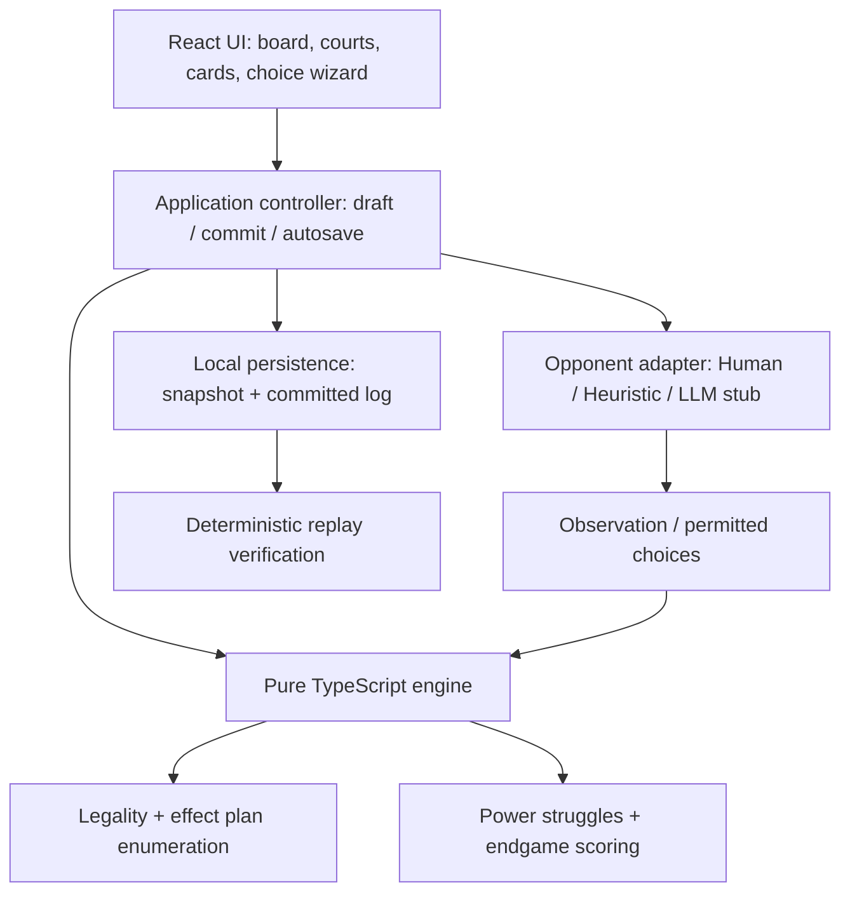

# KingIsDead — High-Level Design

**Status:** Milestones 0–5 implemented; remaining sections are the implementation blueprint. Standard human hotseat games are playable with a private-hand projection, engine-driven choices, previews, and result panels. Bots/persistence follow in Milestone 6 and full Advanced gameplay in Milestone 7. See [verification report](IMPLEMENTATION_STATUS.md).
The completed-game UI also offers a chronological log of accepted setup, turns,
struggles, and scoring. Its dedicated projection is available only after final
scoring and includes historical played actions while excluding setup hands,
unplayed cards, and undealt Cunning cards.
**Authority:** `the_king_is_dead_2nd_edition_rulebook.md` (user-supplied Project Ruleset — 2–3 Players).

**Stack:** React, TypeScript, Vite, Vitest; no backend for the first version.

**Scope:** Human, algorithmic bot, and _unconnected_ provider-neutral LLM adapter. Standard and Advanced games, two or three independent players; three players is the primary experience.

> **Rule of authority:** The project rulebook takes precedence over external sources and common board-game conventions. If it does not define an outcome, do not invent one. Record a question for the user and update the rulebook, design, and tests after clarification. Do not silently replace a missing LLM provider with an algorithmic opponent.

## 1. Goals and non-goals

### Goals

1. Correctly execute the **entire supplied project ruleset**, including its explicit variants, at 2–3 players in Standard and Advanced modes.
2. Make it easy to play on a MacBook using mouse/keyboard, with clear legal choices, previews, explanatory outcomes, and **Reset Turn** / **End Turn**.
3. Make rules and game state completely independent of React, browser APIs, randomness, UI layout, and any AI provider.
4. Make every accepted action, pass, setup result, power struggle, Plot choice, and final outcome auditable and replayable.
5. Make opponents swappable behind one controller interface and maintain information boundaries.
6. Support save/resume of full game state and chronological log; maintain deterministic reproduction of setup and accepted moves.
7. Make ambiguity visible, not silently fill it with a guess.

### Non-goals for v1

- Server multiplayer, accounts, matchmaking, mobile app packaging, real-time networking.
- Live LLM API or local-model integration, provider/model configuration, or LLM deployment.
- Four-player team play (not included in supplied project scope).
- Photorealistic or copyrighted board artwork, complex animations, music, or broad UI component frameworks.
- Training a game-playing model or claiming the heuristic opponent is strong.

## 2. System components



**Dependencies flow inward:** `ui` and `app` may import `engine`; `engine` must never import React, UI code, Web Storage, AI libraries, DOM APIs, or network APIs.

### Proposed repository layout

```text
src/
  game/
    domain.ts                 # Faction, Region, cards, typed IDs, phases
    board.ts                  # Approved 13-edge undirected region graph
    setup.ts                  # Seeded 2/3-player Standard/Advanced setup
    state.ts                  # Canonical committed game state
    legal.ts                  # Legal card/effect/summon/Plot choices
    effects/
      common.ts               # Transfers, placement/removal, partial tiers
      standard.ts             # 7 Standard card types (2 Assemble instances)
      cunning.ts              # 12 Cunning card definitions
    turns.ts                  # Validate + atomically commit pass/card turns
    struggles.ts              # Resolve next region by numbered card slot
    scoring.ts                # Coronation/Invasion/Plot/unresolved tie
    visibility.ts             # Redacted per-player observation model
    events.ts                 # Typed accepted events + audit metadata
    replay.ts                 # Replay and compare reconstructed state
    invariants.ts             # Follower conservation, hands, regions, etc.
    rng.ts                    # Injectable seeded deterministic RNG
  agents/
    controller.ts             # Shared controller interface
    randomBot.ts              # Uniform/simple legal-plan baseline
    heuristicBot.ts           # Legality-first evaluation + move choice
    llmAdapter.ts             # Contract + deterministic fake, NO live API
  app/
    gameController.ts         # Session state, bot advance, commit handling
    draft.ts                  # Non-authoritative turn draft + reset
    persistence.ts            # Versioned browser saves and reloads
  components/
    GameSetup.tsx
    GameBoard.tsx
    Region.tsx
    ActionHand.tsx
    TurnBuilder.tsx
    CourtAndSupply.tsx
    PowerStruggleTrack.tsx
    GameOver.tsx
    HotSeatCurtain.tsx        # Hide another human's hand during handoff
  App.tsx
  main.tsx
  styles.css
```

Organize differently if the repository already has reasonable conventions; **retain the architectural boundaries**.

## 3. Domain model

Use discriminated unions and named IDs instead of scattered strings. All persistent data is JSON-serializable. Suggested _shape_, not a requirement to copy exact property names:

```ts
type Faction = "scottish" | "welsh" | "english";
type RegionId =
  | "moray"
  | "strathclyde"
  | "lancaster"
  | "northumbria"
  | "gwynedd"
  | "warwick"
  | "essex"
  | "devon";
type PlayerId = string;
type FactionCounts = Record<Faction, number>;
type RegionControl =
  | { kind: "unresolved" }
  | { kind: "faction"; faction: Faction; struggleIndex: number }
  | { kind: "unstable"; struggleIndex: number };

interface RegionState {
  id: RegionId;
  followers: FactionCounts;
  control: RegionControl;
}
interface RegionCardSlot {
  slot: number; // 1..8, the power-struggle order
  regionId: RegionId;
  faceUp: boolean;
  negotiationDiscOwner: PlayerId | null; // marker belongs to card, not slot
}
interface PlayerState {
  id: PlayerId;
  controller: "human" | "algorithmic" | "llm";
  court: FactionCounts;
  hand: CardInstance[]; // includes unplayable Plot, if held
  discards: CardInstance[]; // last/top visible to other players
  negotiationDiscLocation: RegionId | null; // null == available
  lastActionSequence: number | null;
}
interface GameState {
  rulesVersion: string;
  playerOrder: PlayerId[];
  startingPlayerId: PlayerId; // randomly selected ONCE in setup
  activePlayerId: PlayerId;
  mode: "standard" | "advanced";
  regions: Record<RegionId, RegionState>;
  regionCards: RegionCardSlot[];
  supply: FactionCounts;
  removedFromGame: FactionCounts; // 2 per faction in 2-player games
  players: Record<PlayerId, PlayerState>;
  consecutivePasses: number;
  turnSequence: number; // every accepted pass/card turn
  actionSequence: number; // accepted card actions ONLY
  lastSwap: SwapMemory | null; // last action's effective swap, before summoning
  eventSequence: number; // last accepted event, including struggles/end triggers
  rngState: unknown; // concrete serializable RNG state
  phase: "turn" | "scoring" | "plot-choice" | "finished";
  ending: "invasion" | "coronation" | null;
  plot: RevealedPlot | null; // owner/card/faction; faction null until committed
  result: GameResult | null;
}
```

Store the **54-follower total** (18 per faction) explicitly through `removedFromGame` (2 per faction in two-player mode), supply, courts, and regional cubes. The game must not invent or destroy followers. Controlled/unstable regions are permanently empty following a struggle.

Track each individual **card instance** with a stable ID: there are two separate Assemble instances per hand. The 12 Cunning card types are unique cards dealt without replacement across players. Use no hidden extra cards.

### Canonical state versus draft

The **committed `GameState`** is authoritative and should not change while the user is composing a turn. A separate `TurnDraft` references the starting state version/turn sequence and contains selected physical card, copied effect, ordered target/follower transfers, optional region-card swap/disc choice, and summon choice. Derive a **preview state** by applying a candidate effect to a copy. `Reset Turn` discards this draft and preview with no accepted log entry. `End Turn` revalidates the completed plan against the current committed state and commits **atomically**. A pass is drafted and committed the same way.

Only accepted card actions increment `actionSequence`; passes and summons are not independent card actions and do not affect last-action tiebreaks or anti-undo release.

## 4. Legal-plan and execution contract

Avoid hard-coding game rules into JSX or bot logic. Expose a shared, deterministic public API:

```ts
createGame(config: SetupConfig, rng: Rng): SetupResult
getObservation(state: GameState, viewer: PlayerId): PlayerObservation
getAvailableCards(state: GameState, player: PlayerId): CardInstance[]
enumerateEffectPlans(state: GameState, player: PlayerId, cardId: string): EffectPlan[]
enumerateSummonChoices(afterEffect: GameState): SummonChoice[]
previewTurn(state: GameState, draft: TurnDraft): DraftPreview
commitTurn(state: GameState, plan: TurnPlan): CommitResult
resolvePlotChoice(state: GameState, choice: PlotChoice): CommitResult
assertInvariants(state: GameState): void
replay(log: AcceptedEvent[]): GameState
```

Concrete names can differ. Each legal effect plan should be a **canonical, structured description** (ordered transfers with source/destination/faction/count, card-position swaps, disc markers and/or no-effect), not a callback or UI procedure. The engine verifies rather than trusting a UI-provided plan ID. Plans must work identically for humans and bots.

### Partial actions and effect tiers

- Compute the highest achievable tier **over all legal targets** before showing target choices; only retain plans at the maximum tier.
- Represent an effect as ordered operations so removal can replenish supply for a later placement **in the same action**.
- Handle `noEffect` as a legal card-action effect where the rulebook permits it; a post-effect summon is still mandatory if available.
- Summon exactly one follower from an _uncontrolled region_ after the effect, or record **zero with reason** if every unresolved region is empty. Never summon from supply.
- Use faction-count transfers, not artificial identities for physically indistinguishable cubes. A full reverse swap is compared using transfer multisets, **separate from the later summon**.
- Track last relevant swap's **effective** card (`Manoeuvre`/`Outmanoeuvre`) and actor. The prohibition persists over passes and summoning, and ends after any other committed card action. Spy copying a swap obeys the same restriction.
- Negotiate operates on eligible face-up unmarked _region cards_. The actor's disc is spent on first use (whether Spy or ordinary Negotiate). A later Negotiate effect swaps cards without producing a new disc.

Keep generation manageable through counts, canonical sorting/deduplication of equivalent plans, staged choices in the UI, and memoized observations; don't enumerate individual indistinguishable cube identities. Verify any pruning preserves completeness of highest-tier legal options.

## 5. Sequence and turn lifecycle

```mermaid
stateDiagram-v2
  [*] --> Setup
  Setup --> AwaitTurn: seeded setup + random starting player
  AwaitTurn --> DraftPass: choose Pass
  AwaitTurn --> DraftEffect: choose playable card
  DraftPass --> AwaitTurn: Reset Turn
  DraftEffect --> AwaitTurn: Reset Turn
  DraftEffect --> DraftSummon: effect plan selected/applied to preview
  DraftSummon --> AwaitTurn: Reset Turn
  DraftPass --> Commit: End Turn
  DraftSummon --> Commit: End Turn (summon or justified zero)
  Commit --> AwaitTurn: not all passed
  Commit --> PowerStruggle: consecutive passes = player count
  PowerStruggle --> AwaitTurn: game not over
  PowerStruggle --> Scoring: terminal trigger; normal turns end
  Scoring --> PlotChoice: Plot held
  Scoring --> Finished: no Plot
  PlotChoice --> Finished: endgame faction chosen
```



Every action or pass after commitment advances to the next clockwise player. A power struggle occurs immediately when **all players pass consecutively**; afterward reset pass streak and resume the next player in sequence. Resolve the lowest-numbered remaining face-up region card (not a fixed geographical order). French invasion on the third instability disc has priority because it ends immediately; otherwise coronation when the eighth region resolves.

### Endgame scoring

The engine executes every Standard effect and automatically finalizes a terminal
struggle through `scoring`. With no held Plot, that same commit emits
`GameFinished`. With a held Plot, it emits `PlotRevealed` and enters `plot-choice`;
only its owner can commit a faction against the current event cursor. That atomic
decision emits `PlotChosen` and `GameFinished`. The virtual follower affects
scoring only; physical inventory, cards, turn/action timing, and RNG stay fixed.
Other Cunning effects remain a Milestone 7 responsibility.

Committed snapshots use schema version 4 with revealed/selected Plot metadata and
structured scoring details. Results record physical/scoring courts, complete
sets, last action times, faction wins/latest victory, all allowed faction
rankings, each comparison's values and survivors, and the outcome per case.
Player IDs sort only presentation; no unresolved tie uses that order. Finished
state invariants recompute and compare the complete cached result. Pure scoring
accepts a pending virtual Plot preview but cannot replace a committed choice.

Drafts remain separate and never create accepted events. Swap memory survives
passes, compares pre-summon transfer multisets, and is replaced or cleared by
every committed card action. Physical Spy cards can preserve an effective swap
identity at this boundary; actual copy-selection rules are not yet implemented.

- **Invasion:** complete follower sets (`min(scottish, welsh, english)`), then most recent accepted card action; if all tied players never acted, an explicit unresolved draw.
- **Coronation:** rank factions by controlled-region victories; break equal region counts by latest struggle won. If tied factions never won, enumerate all **rule-consistent** permutations: winner only if every permutation returns the _same unique player_, otherwise unresolved draw.
- Count leading faction support, then second faction support; check Plot owner's final tiebreak override **only after** those comparisons; finally compare earliest **last** action, with never-acted earlier than acted. Equal never-acted candidates -> unresolved draw.
- **Plot:** not a playable action. At game end, reveal it and choose one virtual faction follower for final scoring; don't change supply, regional control or action time. In invasion it helps complete sets; coronation it has special final-tiebreak priority.
- Final `GameResult` is a discriminated union `{kind:'win', winner, method, explanation, details}` or `{kind:'draw', contenders, method, reason, rankingCases?, details}`. A draw is a valid game result, not an error.

## 6. Controller boundary: human, algorithmic bot, LLM adapter

```ts
interface GameControllerAdapter {
  readonly kind: "human" | "algorithmic" | "llm";
  chooseTurn(
    input: PlayerObservation,
    legalOptions: LegalOptions,
  ): Promise<TurnPlan>;
  choosePlot?(input: PlayerObservation, options: Faction[]): Promise<Faction>;
}
```

- The app orchestrator controls **when** each controller may move; the engine always checks the submitted plan.
- Bot observations must include only publicly visible information and their **own** hand/discards. Other hands, buried discards and undealt Cunning cards are hidden. Likewise, the display must not leak them through tooltips or logs.
- Implement a deterministic baseline bot (seeded/random legal choices) and a heuristic bot (simple region-control, court influence, timing/hand-cost priorities). Strength is secondary to correctness.
- LLM adapter: define a serializable observation/decision schema; implement a scripted/deterministic mock and clear `NotConfigured` state. **No API keys, provider SDK, or network calls in v1.** Never silently fall back to the heuristic bot if LLM is selected but unconfigured.
- For multiple local human players, use a handoff privacy curtain that hides prior player's cards before revealing next player's hand. This is a UX/privacy choice, not a new game rule.

## 7. UI/UX

**Desktop-first responsive browser UI.** Show an original simplified SVG/CSS map (not a copy of publisher art) with eight clickable regions and 13 verified adjacency links. A schematic can be geographically approximate; adjacency and rule validation come from `board.ts`, not pixel position.

Main layout:

1. Top bar: mode, active player, remaining region struggles, victory status, save/new game.
2. Board: region names, grouped follower counts, control/instability markers, clear legal source/destination highlights; keyboard navigable.
3. Power struggle track: eight numbered region cards, face-up/face-down, negotiation discs and current upcoming region.
4. Side area: all courts as publicly known follower counts, supply/France instability discs, public top discard (others' buried discards hidden).
5. Current player area: private hand (with Plot unplayable), Pass button, card-specific step-by-step Turn Builder, live preview, **Reset Turn**, **End Turn**.
6. Endgame: Plot faction selector when relevant, scoring comparison, explanation of winner or unresolved draw, new game.

Disabled controls explain **why** a target is illegal; don't make players guess. Display pending draft and confirmed board distinctly. UI should be usable with keyboard and mouse, with accessible buttons, focus management, and a distinct first-game tutorial/help panel.

## 8. Event log, replay, and persistence

Use an **append-only typed accepted-event log**, with a versioned initial setup event and explicit random setup result. Event types include `GameCreated`, `TurnCommitted` (pass/card with physical/effective card, legal plan, ordered operations, summon/zero reason), `PowerStruggleResolved`, `GameEndTriggered`, `PlotRevealed`, `PlotChosen`, and `GameFinished`. Post-setup records include actor, event cursor, turn/action sequence and resulting effects. **Never append drafts or Reset Turn**.

Recommended local storage: versioned JSON save containing `{schemaVersion, rulesVersion, committedState, acceptedEvents, rngState}`; validate on load before trusting it. Offer Save/Resume/Export JSON and optionally auto-save after accepted events. Replay from the initial setup event and committed choices, then assert equality with the stored canonical state, or explicitly mark unsupported older schemas. A replay viewer can be added after deterministic reconstruction exists.

Logs and exported saves contain potentially hidden game information. Keep full internal log available only to the engine/debug layer; present per-player **redacted** public history. Do not expose undealt cards in public UI. With no backend, client save files are not a security boundary against a determined local user; document this limitation.

## 9. Quality architecture

- Unit tests: Vitest for graph, seeded setup, every card/partial priority, anti-undo and Spy, mandatory summon, powers struggles, faction ranking, Plot and both endings.
- Property/invariant tests: non-negative counts, per-faction conservation including the removed-to-box pool, no followers in resolved regions, card/disc uniqueness, region cards a permutation of eight, 8-card hands at setup, no illegal moves into resolved regions.
- Simulation tests: deterministic bot-vs-bot games in all four configurations (2/3 players × Standard/Advanced); bounded legal progression and eventual terminal outcomes without crashes.
- UI tests: Vitest + jsdom + React Testing Library and user-event (add only when UI testing begins): card select, legal highlights, Reset/End Turn, pass, bot progress, Plot, hidden-hand privacy.
- CI/local scripts: `npm run typecheck`, `npm run lint`, `npm run test:run`, `npm run format:check`, `npm run build`.
- Avoid any bypass of error checking, test assertions or rule validations to get a green check.

## 10. Architectural decisions and risks

| Decision                            | Why                                                 | Risk/mitigation                                       |
| ----------------------------------- | --------------------------------------------------- | ----------------------------------------------------- |
| Pure immutable rule engine          | One authoritative source for humans, bots and tests | Guard against state mutation with tests/freeze in dev |
| Staged plans, commit atomically     | Matches Reset Turn / End Turn rule                  | Validate all state-dependent selections at commit     |
| Typed event log + snapshot          | Auditable saves, reproducible tiebreaks and replay  | Schema versioning and load validation                 |
| Legal tier computed globally        | Prevents weak-target partial-action exploits        | Property tests and deliberate edge fixtures           |
| Faction counts, not cube identities | Prevents combinatorial blowup                       | Preserve ordered transfers for anti-undo              |
| Per-player redacted observations    | Avoids bot/UI hidden-information cheating           | Explicit visibility tests                             |
| One UI runtime in browser           | Small stack, no backend dependency                  | Local-only save/security tradeoffs                    |
| LLM adapter not connected           | Exactly matches project rulebook                    | Show disabled/not-configured state, not fake bot      |

## 11. Rulebook traceability (selected critical locations)

- Scope, precedence, random start, LLM deferred: lines 7–27, 159–173.
- Approved 13-edge board: lines 73–127.
- Draft/commit/log: lines 177–205.
- Power struggle/controlled regions/summoning: lines 208–243.
- Global partial-action priorities: lines 251–272.
- Invasion/coronation/tiebreaks/draws: lines 304–337.
- Negotiate/Spy discs and swap anti-undo: lines 378–426 and 433–442.
- Plot and Cunning cards: lines 431–534.

**No unresolved rule may be decided by the agent solely because it makes implementation easier.**
