# SQLite game storage

The initial Standard-game persistence adapter is implemented through
`src/server/repository.ts` and a same-origin Node API in development/local preview.
Browser localStorage still holds public display logs and a pending-save outbox;
SQLite stores the exact typed history/checkpoints. The schema also describes
future Advanced storage, but the current API accepts Standard games only.
See [the runnable workflow](../ml/README.md) and
[ML implementation report](BOT_ML_IMPLEMENTATION.md).

- [Executable schema](sqlite/schema.sql)
- [Nine retrieval and analysis queries](sqlite/queries.sql)
- [Training storage/capture contract](SQLITE_TRAINING.md)
- [Training migration 2](sqlite/002_training.sql)
- [Indexed training queries](sqlite/training_queries.sql)
- [Portable training-file schema](sqlite/training_export.sql)

## Recommendation

Keep the original accepted engine events as the historical record. In the same
transaction, write relational projections of turns, effects, struggles and
results, plus a checkpoint after each accepted command. Events preserve the
precise decisions; the projections make ordinary analysis simple SQL; the
checkpoints make progress retrieval and resume practical.

The current `GameLogEntry.heading` and `details` strings should remain display
output. They are unsuitable as the primary analytical representation: wording
can change, and parsing them loses typed card effects, sequence clocks and
scoring details.

## Tables and relationships

| Tables                                       | Purpose                                                                           |
| -------------------------------------------- | --------------------------------------------------------------------------------- |
| `games`                                      | Existing `king-UUID` public ID, rules, provenance, lifecycle and progress cursor  |
| `game_players`                               | Immutable clockwise seat, engine ID, name, controller and exact bot configuration |
| `bot_configs`                                | Strategy, algorithm version, code revision and resolved parameters                |
| `game_events`                                | Ordered accepted events, including setup and final scoring                        |
| `game_commands`                              | Idempotency keys and accepted event ranges for each command                       |
| `turns`                                      | One row per pass or card turn, with card identity and mandatory summon            |
| `turn_transfers`, `turn_region_swaps`        | Ordered physical card effects, independently of summoning                         |
| `struggles`                                  | Region, control decision and follower counts before clearing the region           |
| `game_snapshots`                             | Full internal state at setup and after every accepted command                     |
| `player_snapshots`, `region_snapshots`       | Queryable courts, hand counts, board followers, order and negotiation markers     |
| `game_results`, `player_results`             | Final method and an outcome/point share for every seat                            |
| `bot_decisions`                              | Budgets, actual search statistics, explanations, failures and commit linkage      |
| `legacy_archives`                            | Lossless preservation of the existing public JSON exports                         |
| `regions`, `card_types`, `schema_migrations` | Valid identifiers and schema migration bookkeeping                                |

Each child row belongs to a game through a foreign key. Composite keys such as
`(game_id, event_seq)` prevent accidentally linking a turn to another game's
event. Small integer internal game IDs keep these repeated keys compact; the
existing public ID remains unique and is used in URLs and API requests.

Names are labels, not cross-game identities. An optional account ID supports
human analysis later without merging unrelated people who picked the same
name. `seat` is zero-based clockwise position; it is not starting order. Store
the starting seat separately because a different seat can begin the game.

The three faction count columns are intentional: this game's fixed factions
make court/board queries straightforward. Region and card identifiers have
lookup tables. Extend the schema with a migration if the rules add factions.

## Entity relationship diagram

The diagram includes the 19 base game-storage tables and their key fields.
The seven training tables are defined separately in migration 2. Multiple `PK` fields
within a table form one composite primary key; composite foreign keys also
include `game_id` to keep references inside the same game. Relationship labels
group repeated references to the card and region lookup tables. See the SQL
schema for the complete columns, constraints and individual foreign keys.

```mermaid
erDiagram
    direction TB

    games {
        INTEGER id PK
        TEXT public_id UK
        TEXT mode
        TEXT rules_version
        TEXT status
        INTEGER player_count
        INTEGER starting_seat FK "Together with id; deferred"
        INTEGER last_event_seq
        INTEGER last_turn_seq
        INTEGER last_action_seq
    }
    game_players {
        INTEGER game_id PK, FK
        INTEGER seat PK
        TEXT engine_player_id "Unique within game"
        TEXT display_name
        TEXT controller
        INTEGER bot_config_id FK "Nullable"
        TEXT account_id "Nullable"
    }
    bot_configs {
        INTEGER id PK
        TEXT strategy
        TEXT version
        TEXT code_revision
        TEXT params_json
        TEXT config_hash UK
    }
    game_events {
        INTEGER game_id PK, FK
        INTEGER event_seq PK
        INTEGER turn_seq
        INTEGER action_seq
        TEXT event_type
        INTEGER actor_seat FK "Nullable for setup"
        INTEGER payload_version
        TEXT payload_json
    }
    game_commands {
        INTEGER game_id PK, FK
        TEXT request_id PK
        TEXT request_hash
        INTEGER base_event_seq "Unique within game"
        INTEGER last_event_seq FK
    }
    turns {
        INTEGER game_id PK, FK
        INTEGER turn_seq PK
        INTEGER event_seq FK "Unique within game"
        INTEGER actor_seat FK
        TEXT kind "Pass or card"
        INTEGER action_seq "Nullable; unique within game"
        TEXT card_instance_id "Nullable; unique within game"
        TEXT card_type FK
        TEXT effective_card FK
        TEXT summon_region FK
        TEXT summon_faction
    }
    turn_transfers {
        INTEGER game_id PK, FK
        INTEGER turn_seq PK, FK
        INTEGER operation_index PK
        TEXT faction
        INTEGER count
        TEXT from_region FK "NULL means supply"
        TEXT to_region FK "NULL means supply"
    }
    turn_region_swaps {
        INTEGER game_id PK, FK
        INTEGER turn_seq PK, FK
        INTEGER operation_index PK
        TEXT first_region FK
        TEXT second_region FK
        TEXT negotiation_disc_on FK "Nullable"
    }
    struggles {
        INTEGER game_id PK, FK
        INTEGER struggle_index PK
        INTEGER event_seq FK "Unique within game"
        INTEGER turn_seq FK
        TEXT region FK "Unique within game"
        TEXT control_kind
        TEXT faction "Nullable for instability"
        INTEGER scottish
        INTEGER welsh
        INTEGER english
    }
    game_snapshots {
        INTEGER game_id PK, FK
        INTEGER event_seq PK, FK
        INTEGER turn_seq
        TEXT phase
        INTEGER active_seat FK
        INTEGER state_schema_version
        TEXT state_json
    }
    player_snapshots {
        INTEGER game_id PK, FK
        INTEGER event_seq PK, FK
        INTEGER seat PK, FK
        INTEGER hand_count
        INTEGER scottish
        INTEGER welsh
        INTEGER english
        INTEGER last_action_seq
    }
    region_snapshots {
        INTEGER game_id PK, FK
        INTEGER event_seq PK, FK
        TEXT region PK, FK
        INTEGER slot "Unique within checkpoint"
        INTEGER face_up
        TEXT control_kind
        TEXT controlling_faction
        INTEGER negotiation_disc_seat FK "Nullable"
        INTEGER scottish
        INTEGER welsh
        INTEGER english
    }
    game_results {
        INTEGER game_id PK, FK
        INTEGER event_seq FK
        TEXT kind "Win or draw"
        TEXT method "Invasion or coronation"
    }
    player_results {
        INTEGER game_id PK, FK
        INTEGER seat PK, FK
        TEXT outcome "Win, draw or loss"
        INTEGER share_denominator "Nullable for loss"
        REAL score "Generated point share"
    }
    bot_decisions {
        INTEGER id PK
        INTEGER game_id FK
        TEXT request_id "Unique within game"
        INTEGER seat FK
        INTEGER base_event_seq FK
        INTEGER committed_turn_seq FK "Nullable; unique within game"
        TEXT status
        INTEGER budget_iterations
        REAL budget_time_ms
        INTEGER search_seed
        REAL elapsed_ms
        INTEGER iterations
        TEXT plan_json
    }
    regions {
        TEXT region_id PK
    }
    card_types {
        TEXT card_type PK
    }
    schema_migrations {
        INTEGER version PK
        INTEGER applied_at_ms
        TEXT checksum
    }
    legacy_archives {
        TEXT public_id PK
        INTEGER imported_at_ms
        TEXT archive_json
    }

    games ||--|{ game_players : "clockwise seats (2 or 3)"
    game_players ||..o| games : "starting seat"
    bot_configs |o..o{ game_players : "optional configuration"
    games ||--|{ game_events : "accepted history"
    game_players |o..o{ game_events : "actor except setup"
    games ||--|{ game_commands : "accepted requests"
    game_events ||..o{ game_commands : "last event in batch"
    game_events ||..o| turns : "committed turn"
    game_players ||..o{ turns : "actor"
    turns ||--o{ turn_transfers : "ordered transfers"
    turns ||--o{ turn_region_swaps : "ordered card swaps"
    game_events ||..o| struggles : "resolution event"
    turns ||..o| struggles : "triggered by final pass"
    game_events ||--o| game_snapshots : "checkpoint after batch"
    game_players ||..o{ game_snapshots : "active seat"
    game_snapshots ||--|{ player_snapshots : "courts and hands"
    game_players ||--o{ player_snapshots : "seat history"
    game_snapshots ||--|{ region_snapshots : "eight board regions"
    game_players |o..o{ region_snapshots : "optional negotiation marker"
    games ||--o| game_results : "terminal result"
    game_events ||..o| game_results : "GameFinished event"
    game_results ||--|{ player_results : "outcomes for all seats"
    game_players ||--o| player_results : "seat outcome"
    game_players ||..o{ bot_decisions : "search attempts"
    game_events ||..o{ bot_decisions : "observed base position"
    turns |o..o| bot_decisions : "optional committed decision"
    card_types |o..o{ turns : "printed and effective cards"
    regions |o..o{ turns : "optional summon region"
    regions |o..o{ turn_transfers : "source and destination"
    regions ||..o{ turn_region_swaps : "swapped regions and optional marker"
    regions ||..o{ struggles : "resolved region"
    regions ||..o{ region_snapshots : "region history"
```

Circles indicate optional participation, a single bar means one, and a crow's
foot means many. Solid lines identify children through their parent keys;
dashed lines represent other references. `schema_migrations` and
`legacy_archives` are deliberately independent: old public exports are not
assumed to contain a verified engine event stream.

## Capture the actual engine semantics

The engine has three different sequence clocks:

- `event_seq`: every accepted event, starting at zero for `GameCreated`.
- `turn_seq`: increments for passes and card plays.
- `action_seq`: increments only for cards. A pass retains the cumulative
  action clock in its event, but has NULL `turns.action_seq`.

A single pass may produce `TurnCommitted`, `PowerStruggleResolved`,
`GameEndTriggered` and `GameFinished`. Keep their separate event rows and
order. Never assume one turn equals one event or that the highest turn number
uniquely identifies a state: Advanced Plot choices can advance events without
advancing turns.

Checkpoints use the **last event of a whole accepted command's batch**. Store
setup at event zero and a complete checkpoint after every subsequent accepted
command, including Plot choices. For this eight-region, two/three-seat game,
this buys simple history queries without introducing sparse-checkpoint logic.
Measure actual database size before changing checkpoint frequency.

`state_json` stores the complete versioned `GameState`, including supply,
control discs, instability, hand identities, discards, negotiation markers,
RNG state and anti-undo memory. The relational snapshot children are derived
facts for the same exact state, not independently maintained counters.

`struggles` stores `returnedToSupply`, which represents follower counts just
before resolution. The subsequent snapshot has zero followers in that resolved
region. Both are necessary to explain why a region became controlled or unstable.

Store the original `GameFinished` event, including its result details, scoring
cases, tiebreak steps and virtual Plot support. A draw can involve only two of
three seats: write those seats as draws with score 1/2 and the other as a loss.
For a three-way draw use 1/3; for a win use 1 for the winner and 0 for everyone
else. `player_results.score` is generated from an integer denominator.

## Bot reproducibility and analysis

Do not group solely by `informed`, `patient` or `reference`. Store the exact
algorithm version, source revision and **resolved** parameters, even when all
parameters are defaults. Hash a canonical serialization of those fields to
deduplicate immutable `bot_configs` rows. Missing historical versions remain
unknown; do not infer them from today's defaults.

Record each search budget and seed, actual iterations/time/depth, tree reuse,
selected plan and explanation in `bot_decisions`. Capture them when the Worker
reply arrives: the current orchestration commits its plan but does not persist
the returned statistics. Link a successful decision only when its turn is
accepted. Keep failed, cancelled and stale attempts out of `turns`.

Store environment metadata such as runtime/device class when collecting
timings. Fixed iterations do not imply equal CPU time. A wall-clock-limited
search can vary by device even with the same search seed, and tree reuse means
the seed alone does not reproduce the search. Accepted plans and checkpoints
still reproduce the played game; reproducing every search requires its prior
search context or explicitly disabled reuse.

Separate live play, benchmarks and imports using `source`. Use `dataset` to
separate training/tuning/held-out runs, and `setup_group` to pair seat rotations
of a setup. Analysis should filter rules version, mode, player count, opponent
configurations and budgets. When reporting benchmark uncertainty, resample
whole setup groups; seat rotations are not independent samples. Card-use/win
correlations describe games, not the causal value of a card.

## Transaction and retry protocol

All canonical writes go through one server-side repository. Never write UI
drafts, previews, reset selections or speculative bot moves to the event log.

1. Validate the command with the existing engine and obtain its accepted event
   delta and final state. Load the persisted base state first if the server
   does not already have an authoritative copy.
2. Open a short `BEGIN IMMEDIATE` transaction. Look up `(game_id, request_id)`.
   A retry with the same canonical request hash returns the previously accepted
   event range. A reused request ID with different content is rejected.
3. Check the caller's base event sequence against `games.last_event_seq`.
   Reject a stale command. Do not let concurrent clients overwrite one another.
4. Append the contiguous event batch. Insert its turn/effect/struggle/result
   projections and final checkpoint with all player and region rows.
5. Insert the accepted command row, link any committed bot decision, and advance
   `games`' progress, timestamps and lifecycle. Commit everything together.

Setup uses the same protocol, with base event sequence -1. Its game row and all
seats are inserted in one transaction; the starting-seat foreign key is deferred
until commit. Bot computation happens outside the transaction, never while
holding the write lock. If the lock is busy, retry the transaction with bounded
backoff; elapsed time is not permission to overwrite a newer event cursor.

The database enforces types, nonnegative counts, uniqueness, recognized regions,
and ownership foreign keys. The writer must also validate cross-row invariants:
contiguous clocks, exactly the configured seats, a full set of eight regions per
checkpoint, projection/event equality, legal card effects, conservation of
followers, and a finished result consistent with all player outcomes. These
belong in the engine/repository, not a second game rules engine written in SQL.

Events and bot configurations are append-only through the repository. Correct
a projection by rebuilding it from the accepted events under its schema
version, rather than silently modifying an accepted move. Do not use
`INSERT OR REPLACE` for retries; it can delete an existing row. Use explicit
conflict handling and verify the existing request/event content.

## SQLite operation

The proposed SQL uses `STRICT` tables, JSON stored as validated TEXT, and foreign
keys. SQLite added STRICT in 3.37 and made JSON functions built-in by default
in 3.38; require those capabilities and a currently maintained SQLite runtime.
See [STRICT tables](https://www.sqlite.org/stricttables.html) and
[JSON support](https://www.sqlite.org/json1.html).

Enable `foreign_keys=ON` on **every** connection before starting a transaction;
the setting is connection-specific. Use bound query parameters and a migration
runner that records version, timestamp and file checksum in `schema_migrations`.
Schema, engine state and event payload versions are separate concepts. See
[foreign keys](https://www.sqlite.org/foreignkeys.html).

WAL allows readers alongside a writer, but SQLite still has one writer at a
time. Host the database on the server's local disk; multiple browsers use the
API rather than opening a shared database file over a network filesystem.
The suggested connection configuration uses a busy timeout and `synchronous=FULL`
for durable game saves. For disposable benchmark batches, a separate database
can choose a different durability tradeoff. See
[WAL](https://www.sqlite.org/wal.html) and
[transactions](https://www.sqlite.org/lang_transaction.html).

Use the SQLite backup API or a supported consistent backup mechanism for a live
database; copying just the main file while WAL writes are active is insufficient.
Periodically check `PRAGMA foreign_key_check` and `PRAGMA integrity_check`, and
inspect expensive queries with `EXPLAIN QUERY PLAN`. The provided indexes cover
game lookup, ordered history, latest turns, board checkpoints and analysis cohorts.
Add further indexes from actual query workloads. See the
[backup API](https://www.sqlite.org/backup.html).

## Storage versus disclosure

This database is **private application storage**. Raw `GameCreated` events and
full state checkpoints contain seeds/RNG and hidden Advanced cards. Return
player observations and the existing public log projection from API routes;
never return raw database event/checkpoint JSON as a public game-log response.
Analysts with database access are trusted with that internal information.

The existing version-1 JSON exports contain rendered public logs, not complete
accepted engine events or resumable snapshots. Keep their original JSON in
`legacy_archives`. A future importer may produce structured games only after
reconstructing and verifying them with a compatible engine, recording the import
source and any uncertainty. Do not fabricate missing bot statistics or resume
state by scraping display text into the canonical tables.

## Implementation order

Start with a server-side migration and transactional persistence adapter for
setup, `commitPlan`, and Plot choices. Add API endpoints to find games by public
ID, page public history and resume an authorized session. Then persist bot
search results and add analysis endpoints based on the supplied views/queries.
Keep localStorage export/import available while centralized persistence is
introduced. Live Standard gameplay now uses this adapter. The accompanying synthetic
training file is only a format demonstration. Existing display archives are not
automatically migrated into typed history.

## Training extension

The user prefers SQLite for capture and training retrieval. Apply migration 2
from [SQLITE_TRAINING.md](SQLITE_TRAINING.md) after this base schema. Keep exact
accepted game data in these base tables and cache encoder-versioned float32
vectors in the training tables. The trainer reads frozen dataset membership
with indexed batches and correctly rotated outcome labels. It does not replay
JSON or join every board projection on each training epoch.

The contract includes capture fields, API/write flow, dataset-family isolation,
source/model provenance, binary vector layout, example queries and a portable
training-only file. Raw database access remains private; portable feature
exports omit names and internal setup data. Existing browser display archives
cannot automatically populate those features without validated reconstruction.
