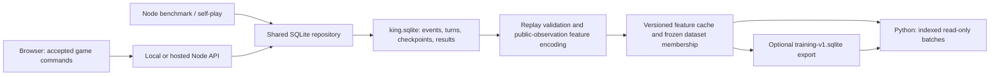

# SQLite capture and training data contract

Implemented initial capture/training pipeline 2026-10-21. SQLite is the durable
store for live Standard games and generated games through a shared Node
repository and same-origin development/local-preview API. Replay validation,
feature caching, frozen dataset construction and portable exports are wired;
see [ml/README.md](../ml/README.md) for the runnable workflow and
[implementation evidence](BOT_ML_IMPLEMENTATION.md). The SQL fixture example
below remains synthetic; real pilot datasets are generated separately.

## Files and architecture

| File                                                       | Purpose                                                                                           |
| ---------------------------------------------------------- | ------------------------------------------------------------------------------------------------- |
| [sqlite/schema.sql](sqlite/schema.sql)                     | Existing proposal migration 1: canonical game history, exact plans/events, snapshots and outcomes |
| [sqlite/002_training.sql](sqlite/002_training.sql)         | Migration 2: validated games, versioned feature cache, frozen datasets and batch-reading view     |
| [sqlite/training_queries.sql](sqlite/training_queries.sql) | Indexed batch reads, input audits and dataset coverage queries                                    |
| [sqlite/training_export.sql](sqlite/training_export.sql)   | Schema for a separate portable training-only SQLite file                                          |
| [sqlite/validate_training.py](sqlite/validate_training.py) | SQL constraints, perspective-label and query-plan checks; synthetic example generator             |



Use a small Node service on the same machine as the database and Python trainer
initially. The browser uses a same-origin API; it cannot write an arbitrary
SQLite file on the server's filesystem. If browser-only deployment becomes a
hard requirement, SQLite WASM with OPFS is a separate option, with explicit
export/synchronization and runtime constraints. It is not needed for this
server-owned file design. See [SQLite browser persistence](https://sqlite.org/wasm/doc/trunk/persistence.md).

## What must be collected while a game is played

The following data must survive leaving the page. Features, candidate searches
and final labels can be derived later; losing exact moves cannot be repaired by
training code.

| Capture point               | Required data                                                                                                                                                    | Storage                                                                                        |
| --------------------------- | ---------------------------------------------------------------------------------------------------------------------------------------------------------------- | ---------------------------------------------------------------------------------------------- |
| Setup                       | Game UUID; rules/state/event versions; explicit starting position and region order; clockwise seats and starting seat; source/app revision; initial setup record | `games`, `game_players`, `game_events` at event 0, initial `game_snapshots`                    |
| Bot assignment              | Strategy, algorithm version, resolved parameters, search settings and model ID/hash if ML; unknown historical values stay unknown                                | Immutable `bot_configs`; include model identity in its canonical config hash and `params_json` |
| Every accepted command      | Request ID/hash; expected base event cursor; full `TurnPlan` for every card or pass; ordered engine event delta                                                  | `game_commands`, `game_events`, `turns` and effect projections                                 |
| After each accepted command | Complete checkpoint after ALL resulting events, with its final event cursor                                                                                      | `game_snapshots` and existing analytical snapshot projections                                  |
| Bot search, when available  | Search seed/budget, actual time/iterations/tree reuse, chosen plan, failure/cancel status                                                                        | `bot_decisions`; no fabricated visits for human decisions                                      |
| Game ending                 | Structured `GameResult`, ending method, every seat's win/draw/loss share, scoring/tiebreak details                                                               | `GameFinished` event, `game_results`, `player_results`                                         |
| Interrupted/abandoned game  | Last accepted cursor and accurate lifecycle                                                                                                                      | `games`; no fabricated terminal outcome                                                        |

Follower transfers require source, destination, faction, count and operation
order. Region-card swaps require both regions and negotiation-marker placement.
The summon is independent of the card effect and includes explicit zero summons.
A seed or a sentence such as “played Assemble” is not enough to reconstruct this.

Keep the three clocks distinct: `turn_seq` advances on every pass/card,
`action_seq` only on cards, and `event_seq` on every event. A final pass can emit
several events. A training row for turn 12 uses the checkpoint **before turn 12**,
not the state after its card effect or after its struggle.

The source database is private application storage, so it can contain the exact
internal setup/checkpoints described in the original proposal. When generating
ML input, rebuild the actor's public observation and witnessed memory and call
`reconstructStandard`; never encode private setup/RNG fields. Portable training
files omit names, raw checkpoints and setup secrets. Keep Advanced excluded
from this Standard encoder.

## What needs to change in the app

`App.tsx` retains `archiveSnapshot`/`saveArchive` for public display history and
now also passes accepted sessions to `StorageClient`. The latter sends typed
setup/commands through the SQLite API and retains an idempotent per-request
outbox until acknowledgments arrive. Typed history and full checkpoints are
persisted by `src/server/repository.ts`, not reconstructed from display text.

Implement a shared repository and two adapters: browser capture through an API,
and direct Node capture for benchmarks. Use the existing game ID and accepted-
commit boundary, so both humans and bots follow the same path. The current log
UI remains a projection of the stored history.

A concrete initial transport contract:

- `POST /api/games`: idempotency key plus setup configuration/identity; the
  server uses the same TypeScript engine to create/validate the starting game
  and persists the accepted setup and seats atomically.
- `POST /api/games/:id/commands`: request ID, base event cursor, full typed plan
  (or supported Plot choice for non-training storage). The server validates
  against its stored state, appends the resulting events/projections/checkpoint
  in one transaction, and returns the accepted final cursor/result.
- `GET /api/games/:id`: a permitted observation/history projection for client
  reconciliation; raw internal checkpoint JSON is not a public response.

The client can retain its local engine for previews. Serialize outgoing commands
per game and reconcile acknowledgments; duplicate request IDs with identical
content return the prior result, different content or stale base cursors fail.
Do not recompute or silently replace a human move on retry. Distinguish an engine
accepted move from an acknowledged durable save. If play can continue while
network storage is unavailable, preserve an ordered durable outbox and show
pending/error state. Its optional browser storage is a delivery mechanism;
SQLite remains the durable game archive. Offline mode is a separate integration
choice, not an assumption that a failed request was saved.

Implement the original transaction protocol in [SQLITE_STORAGE.md](SQLITE_STORAGE.md).
No long-running bot search, feature generation or training occurs while holding
a database write transaction. On game completion, enqueue replay/materialization
outside the gameplay transaction. Legacy display archives go into
`legacy_archives`; only validated recovered trajectories can enter ML datasets.

## Training tables and invariants

Apply migration 1 and then migration 2; record both checksums in the migration
runner. Existing deployed migrations must not be edited in place.

| Table                   | Main key                                       | Purpose                                                                                          |
| ----------------------- | ---------------------------------------------- | ------------------------------------------------------------------------------------------------ |
| `ml_feature_schemas`    | `version`                                      | Exact encoder revision, input layout/hash, rules version, dimension and binary dtype             |
| `ml_games`              | `game_id`                                      | Completed/replay-validated Standard games; setup-family and trajectory hashes; source provenance |
| `ml_positions`          | Integer `id`; unique game/turn/feature-version | Pre-turn vector plus source checkpoint and canonical-to-original seat mapping                    |
| `ml_datasets`           | Integer `id`; unique name                      | Feature version, split configuration, build/frozen state and manifest hash                       |
| `ml_dataset_families`   | Dataset/family                                 | One train/validation/test split per family in that dataset                                       |
| `ml_dataset_games`      | Dataset/game                                   | Included games; unique trajectory hash prevents duplicate imports in a dataset                   |
| `ml_dataset_samples`    | Dataset/split/ordinal                          | Compact ordered membership and sample weights; feature vectors stored once                       |
| `v_ml_training_samples` | Read-only view                                 | Frozen membership joined to feature BLOBs and correctly rotated result labels                    |

A setup family groups repeated seeds, seat rotations and policy/noise variants
of the same setup. Hash a canonical initial position using stable region/faction
order and player IDs mapped to seat indices, and apply the experiment's grouping
map so related rotations share a family even when their exact serialized seat
allocation differs. A trajectory hash includes rules version, canonical initial
position and accepted commands, excluding display names/UUIDs/timestamps. Track
the hash algorithm/version in dataset configuration. A source digest additionally
binds the actual event stream used in replay validation.

The SQL enforces completed-game admission, feature byte lengths, references to
the correct pre-turn checkpoint, clockwise output mappings, feature-version
consistency, dataset-family split consistency, and frozen membership. It does
not prove game legality: the replay validator checks every committed plan,
checkpoint/event equality, final result and finite/ranged feature values.

Once a game is admitted, keep its events/results immutable through the
repository. Dataset freezing also checks exact member counts, source digests,
content hashes, valid target sums, and global final-test exclusions. The SQL
prevents in-dataset split leakage; a global holdout registry in the dataset
builder must prevent accidentally reusing a final-test family in another
training dataset. Re-encode under a new feature version to fix an encoder;
do not silently mutate inputs already used by a model.

## Binary features and outcome labels

For `standard-v1`, each feature vector has 474 float32 values in little-endian
order: **1,896 bytes per position**, before SQLite/index overhead. Store this as
one BLOB, not 474 SQL rows, a JSON array or hundreds of feature-specific indexes.
Keep searchable metadata in typed columns.

The source position records `c0`, `c1`, `c2`: canonical network slot to original
seat. `c0` is the player about to act. `c2` is NULL at two seats. The training view
retrieves `player_results.score` in this order; absent third-seat target is zero.

Example: original seat 0 won a two-player game, and original seat 1 is about to
act in the sampled position. The mapping is `[1,0,null]` and the label is
`[0,1,0]`, not `[1,0,0]`. For three seats, a draw involving seats 0 and 2 with
seat 2 to act has mapping `[2,0,1]` and label `[0.5,0.5,0]`.

These labels describe realized continuations. All actual visited decisions can
be used, including bot turns in human games and games the bot lost. Unplayed
candidate positions must not be assigned these outcomes. Keep any later search
reanalysis/candidate traces in a separately versioned schema with explicit
provenance; they are not required for initial value training.

## What the final files look like

The live file is a binary database, for example `data/king.sqlite`, containing
both the canonical game tables and the seven ML tables above. During WAL use,
SQLite may also maintain `king.sqlite-wal` and `king.sqlite-shm`.

The trainer can open a consistent copy of that database read-only and consume
`v_ml_training_samples`, or use a compact export created with
[training_export.sql](sqlite/training_export.sql):

```text
training-human-v1.sqlite
  manifest     1 row: dataset name, feature version, dimension, dtype,
               source manifest hash, sample count, source/split metadata
  samples      one row per real pre-turn position:
               id, split, game_key, family_hash, source_kind,
               player_count, turn_seq, feature_count, features BLOB,
               target0, target1, target2, sample_weight
```

Human-readable rendering of a row (the BLOB is described here, not converted
to a string in storage):

```text
id:             1
split:          train
game_key:       <pseudonymous immutable game identifier>
family_hash:    <64-character setup-family hash>
source_kind:    human
player_count:   2
turn_seq:       12
feature_count:  474
features:       BLOB, 1896 bytes, float32 little-endian
(target0, target1, target2): (0.0, 1.0, 0.0)
sample_weight:  1.0
```

A locally generated SQLite example demonstrates the real file format with two
**synthetic schema fixtures**. Generate it with the command at the end of this
document; the binary database is ignored rather than versioned. Its feature version is
`fixture-474-v1`, its manifest says `synthetic: true`, and it is not eligible for
training a real bot. Actual `standard-v1` datasets are created by the implemented encoder/replay
pipeline through the commands in `ml/README.md`.

Training read example using Python and NumPy (not a dependency of the app):

```python
import sqlite3
import numpy as np

with sqlite3.connect("file:training-human-v1.sqlite?mode=ro", uri=True) as db:
    last_id = 0
    while True:
        rows = db.execute(
            """SELECT id, features, target0, target1, target2, player_count, sample_weight
               FROM samples
               WHERE split = ? AND id > ?
               ORDER BY id LIMIT ?""",
            ("train", last_id, 256),
        ).fetchall()
        if not rows:
            break
        x = np.stack([np.frombuffer(r[1], dtype="<f4") for r in rows])
        y = np.asarray([r[2:5] for r in rows], dtype=np.float32)
        present = np.arange(3)[None, :] < np.asarray([r[5] for r in rows])[:, None]
        weights = np.asarray([r[6] for r in rows], dtype=np.float32)
        # Feed x, y, present and weights to the trainer; mask absent-seat logits.
        last_id = rows[-1][0]
```

Before exporting, validate split membership, source hashes and labels. Write a
new temporary export, verify its counts/foreign keys/integrity, close it and
publish it under an immutable filename/hash. No source names, raw private JSON
or setup secrets are needed in the portable file. If distributing data to
others, re-key experiment identifiers consistently for that export.

## Performance decisions

- Write one short transaction per accepted command in live play. For bulk
  generation, use a single ingest writer/queue and batched game transactions;
  generation workers should not contend on one long write transaction each.
- Keep WAL on local server disk, `foreign_keys=ON` per connection, a bounded
  busy timeout, and `synchronous=FULL` for durable live saves. WAL permits
  readers alongside a writer but still only one writer at a time.
  [SQLite WAL](https://sqlite.org/wal.html)
- Keep large JSON/feature payload tables as ordinary integer-rowid tables where
  appropriate; use `WITHOUT ROWID` for compact composite-key membership tables.
  It is not universally faster for large rows.
  [SQLite WITHOUT ROWID guidance](https://sqlite.org/withoutrowid.html)
- Materialize features once per encoder version. Epochs do indexed range reads
  with a bounded batch size; no event replay, `json_extract`, large `OFFSET`,
  or whole-table `ORDER BY random()` in the training loop.
- Generate deterministic sample membership/order once, then use an in-memory
  shuffle buffer or shuffle batches/games with recorded RNG per epoch. For
  source/seat balancing, precompute eligible game/sample ID lists or separate
  indexed streams; avoid hundreds of per-row random database calls.
- Use a stable training export or backup for multi-epoch jobs so training does
  not hold a long live read transaction that prevents WAL checkpoints. Open
  a separate read-only connection in each Python loader process; do not share
  one connection across forked workers. More workers are a measured choice.
- Use the SQLite backup API or a consistent export; copying only a live `.sqlite`
  file can miss WAL contents. [SQLite backup API](https://sqlite.org/backup.html)
- One million feature vectors are about 1.90 GB plus indexes/history. Keeping
  candidate vectors for every alternative is much larger; trace selectively.
  History/snapshot frequency and additional indexes should follow measured
  storage/query costs, not a blanket rule to normalize every field.

Inspect `EXPLAIN QUERY PLAN`, median/p95 batch-read latency, rows/second,
encoding time, write latency, WAL growth and file size on representative data.
The provided checks verify index usage on a tiny fixture, not production
throughput. At larger scales the trainer may export contiguous array shards,
but SQLite can remain the authoritative store and dataset catalog.

## Implementation sequence and verification

1. Add the SQLite repository/API and transactional accepted-event capture.
   Verify human/bot replay, idempotent retries and save-error handling.
2. Add completed-game replay validation and `ml_games` admission. Capture now;
   feature extraction does not need to block collecting useful games.
3. Implement the shared feature encoder and insert `ml_positions` in bounded
   batches, with Python/TypeScript parity tests from the ML plan.
4. Build/freeze dataset membership, verify split isolation and compare source
   mixes. Add the read-only training loader and optional portable export.
5. Profile realistic datasets and adjust batch/index/checkpoint choices using
   the measured workload. Add candidate traces only when ranking experiments
   require them.

Run `python3 docs/sqlite/validate_training.py` for the SQL contract checks.
Generate a new illustrative file without overwriting an existing one:

```sh
python3 docs/sqlite/validate_training.py --example /tmp/training-example.sqlite
```

The fixture checks test the SQL contract. Separate Vitest integration tests and
the recorded pilot exercise real engine replay/capture; `ml:test` covers the
trainer. Keep those different evidence levels clear in reports.
