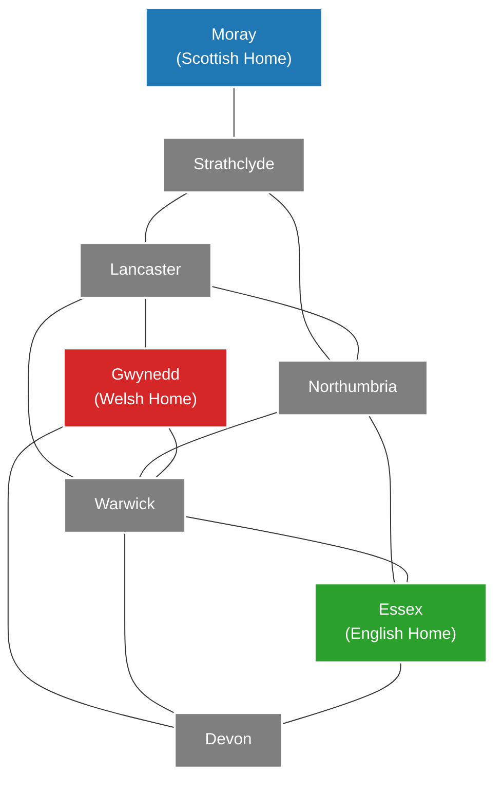

# THE KING IS DEAD

**Second Edition**
_Game Design by Peer Sylvester_
_Illustration by Benoit Billion_

## Project Ruleset — 2–3 Players

This is the living rulebook for this project's **2–3 player game**. Each player
plays independently and may be controlled by a human, an algorithmic bot, or an
LLM bot. Three-player play is the primary experience; two-player play is also
supported. Standard and advanced rules apply at both player counts.

LLM support currently means a provider-neutral **adapter only**, with deterministic
test doubles. Live provider calls, provider/model selection, and deployment of an
LLM service are deferred. Do not describe this as a connected LLM opponent or
silently replace an unconfigured LLM controller with an algorithmic bot.

**User-confirmed project rules take precedence over the published rulebook.**
Choose the first player randomly; this is an intentional project variant. If
anything here conflicts with an official source, or a situation is not covered,
ask the user before choosing a rule. Record each clarification in this document
and update the design, tasks, and kickoff prompt as needed.

The rule clarifications below were supplied by the user. The published rulebook
is a reference, not permission to overwrite an intentional variant:
[Osprey rulebook](https://www.ospreypublishing.com/media/3yxddtqg/tkid2_rulebook.pdf).

---

## Introduction & Lore

The king is dead. The kingdom is divided. Three factions — the Scottish, the Welsh, and the English — vie for control, all too evenly matched to seize it for themselves. As instability builds and foreign invaders loom, Britain is desperate for a ruler. But who should bear that mantle?

You are nobles and powerbrokers, commanding leaders and conniving schemers, intent on claiming the throne. Without the backing to take control for yourself, you will need to gain support from the factions so they may elevate you to ultimate power. You can gently guide the conflicts so your preferred faction ends up on top, but it would be imprudent to pin all your hopes on just one of them...

The throne is empty and the island is in chaos. Will you rise to the occasion and claim the crown for yourself?

---

## Overview

_The King is Dead_ is a game of political upheaval in medieval Britain. Over the course of the game, you will resolve power struggles in the eight regions of the island to determine which faction will prevail and crown the new monarch. Become the preferred candidate of the victorious faction and the kingdom will be yours!

During the game, you will play action cards to manipulate the balance of power across the board. You will have **only eight cards throughout the entire game**, so choosing when to make your play and when to sit tight will be your key to victory. Act too soon and your opponents will unravel your carefully made plans, but wait too long and the fate of the island will already be sealed.

Whenever you take an action, you will **summon a follower to your court if one is available after resolving the action**, increasing your influence with one of the factions. Each follower you take will solidify your claim to be that faction's preferred ruler, but will weaken their ability to win power struggles on the board. If no uncontrolled region has a follower, summon zero under the partial-action rule.

Once each region has been claimed, the faction with the most regions takes control, and the player with the most influence in that faction wins.

---

## Game Components

- **54 Follower Cubes**
  - 18 Scottish Followers (Blue)
  - 18 Welsh Followers (Red)
  - 18 English Followers (Yellow)
- **24 Control Discs**
  - 8 Scottish Control Discs (Blue)
  - 8 Welsh Control Discs (Red)
  - 8 English Control Discs (Yellow)
- **3 Instability Discs** (Black)
- **Negotiation Discs** (White): 1 personal disc per player
- **1 Victory Card** (Double-sided: _Coronation_ / _Invasion_)
- **8 Region Cards** (_Moray, Strathclyde, Gwynedd, Lancaster, Northumbria, Warwick, Essex, Devon_)
- **Standard Action Cards:** an identical set of 8 cards per player
- **12 Cunning Action Cards** (Used for the Advanced Game)
- **1 Game Board**

---

## Board Layout Overview

The game board features four main areas:

1. **Regions of Britain:** Eight interconnected regions (_Moray, Strathclyde, Gwynedd, Lancaster, Northumbria, Warwick, Essex, Devon_).
2. **France:** A designated space holding the 3 Instability Discs.
3. **Supply:** A space to hold available follower cubes and control discs.
4. **Numbered Spaces (1 through 8):** Spaces around the perimeter of the board where Region Cards are randomly assigned during setup to define the order of Power Struggles.



## Adjacency list

The user has confirmed that this graph and adjacency list are correct for the
project. Preserve them as the board's connectivity specification.

| Region          | Borders                                       | Connections |
| --------------- | --------------------------------------------- | ----------: |
| **Moray**       | Strathclyde                                   |           1 |
| **Strathclyde** | Lancaster, Moray, Northumbria                 |           3 |
| **Lancaster**   | Gwynedd, Northumbria, Strathclyde, Warwick    |           4 |
| **Northumbria** | Essex, Lancaster, Strathclyde, Warwick        |           4 |
| **Gwynedd**     | Devon, Lancaster, Warwick                     |           3 |
| **Warwick**     | Devon, Essex, Gwynedd, Lancaster, Northumbria |           5 |
| **Essex**       | Devon, Northumbria, Warwick                   |           3 |
| **Devon**       | Essex, Gwynedd, Warwick                       |           3 |

---

## Setup

### Standard Setup

1. **Board:** Place the game board in the middle of the table.
2. **Home Regions:** Place initial followers on their historic strongholds:
   - **2 Scottish Followers** in _Moray_
   - **2 Welsh Followers** in _Gwynedd_
   - **2 English Followers** in _Essex_
3. **Followers:**
   - Place all remaining followers into the cloth bag.
   - **Courts:** Randomly give each player **2 followers** from the bag to place in front of them. This is their starting _Court_.
   - **Regions:** Randomly draw followers from the bag and place them in each region until every region contains **exactly 4 followers**. (For _Moray, Gwynedd, and Essex_, this means adding 2 additional random followers to the 2 home followers already placed there).
   - Place all remaining followers from the bag into the board's **Supply**. Return the cloth bag to the box.
4. **Discs:**
   - Give each player **1 Negotiation Disc**.
   - Place all Control Discs in the Supply.
   - Place all 3 Instability Discs in France.
5. **Cards:**
   - Deal each player a standard hand of **8 Action Cards**:
     - 1× Scottish Support
     - 1× Welsh Support
     - 1× English Support
     - 1× Negotiate
     - 1× Manoeuvre
     - 1× Outmanoeuvre
     - 2× Assemble
   - Do not use the Cunning Action cards in the standard game.
6. **Region Order:** Shuffle the 8 Region Cards and deal one face-up next to each numbered space (1–8) on the board.
7. **Victory Card:** Place the Victory Card near the board where it is easily accessible.
8. **Start Player:** Choose the starting player randomly from all participating players. This is an intentional project variant and must remain the setup rule. Store the result so loading the same game does not choose again.

### Two-Player Setup Adjustment

If playing a two-player game, before starting setup, **return 2 followers of each faction (6 cubes total) to the box**. Proceed with standard setup as normal.

### Advanced Game Setup

If all players are familiar with the game and agree, you can play the **Advanced Game**:

- Remove each player's _Scottish Support_, _Welsh Support_, and _English Support_ cards and return them to the box.
- Shuffle the **12 Cunning Action Cards** and secretly deal each player **3 cards**.
- Return any unused Cunning Action Cards to the box without looking at them. Each player starts with an 8-card hand consisting of: _Negotiate, Manoeuvre, Outmanoeuvre, 2× Assemble,_ and _3 unique Cunning Action cards_.

---

## How to Play

### Turn Structure

Beginning with the start player and moving clockwise, players take turns taking either an **Action** or **Passing**. Play continues around the table until the game ends, periodically interrupted by **Power Struggles**.

- **Taking an Action:** Play a card from your hand face-up onto your discard pile, resolve its effect, and then **summon one follower to your court if one exists in an uncontrolled region after the effect**. If none exists, summon zero.
- **Passing:** Forfeit your turn for the current round. When play comes back to you, you may choose to take an action or pass again. Passing on one round does **not** lock you out of future turns.

### Editing and Committing a Turn

- A player must be able to reset their in-progress turn, including all draft
  effect and summon choices, before the commitment boundary.
- **Reset Turn** restores the state at the beginning of that turn. It does not consume
  a card, move followers, spend a negotiation disc, or record an accepted action.
- **End Turn** commits that player's move immediately. After pressing it, the
  player cannot change that move, even before the next power struggle.
- A pass can also be selected as a draft, reset before commitment, and committed
  with End Turn. The same commitment boundary applies to a card action or pass.

### Internal Action Log

Keep a complete chronological log of every player's committed card action and
pass throughout the game, even when no log is visible to players. Record the
player, turn/action sequence, card and any copied effect, chosen targets,
ordered transfers, summon (including zero and its reason), and resulting events.
Also record setup, power struggles, endgame choices, and the final result so the
accepted game can be replayed. Preserve the full log across save/resume. Draft
edits and resets are not accepted game actions and do not affect tiebreak timing.
Any player-visible log must respect hidden hands and buried-discard restrictions.

### Power Struggles

When **all players pass in sequence**, a Power Struggle occurs immediately:

1. **Identify the Contested Region:** Look at the lowest-numbered space (1 through 8) that still has a face-up Region Card.
2. **Determine Control:**
   - Count the followers in that region. A faction gains control if it has **more followers than each of the other factions individually**. It does not need more than half of all followers. For example, counts of **2 Scottish, 1 Welsh, and 1 English** give control to the Scots.
   - Place a Control Disc of that faction into the region.
   - Return all followers from that region to the Supply.
3. **Instability (Ties or Empty Regions):**
   - If two or more factions tie for the most followers, or if there are no followers in the region, the region becomes **Unstable**.
   - Place an **Instability Disc** (from France) in the region.
   - Return all remaining followers from that region to the Supply.
   - _If 3 Instability Discs are placed on the board, the game ends immediately in a French Invasion._
4. **Conclude Struggle:** Flip the resolved Region Card face-down. The next player in turn order takes their turn as normal.

---

## Rules for Taking Actions

### Controlled vs. Uncontrolled Regions

- Once a region has resolved its Power Struggle and has a Control Disc or Instability Disc placed on it, it is **Controlled**.
- **You can NEVER place or move followers into Controlled regions.** Their balance of power is locked for the rest of the game.

### Summoning Followers to Court

Immediately after resolving your action card's text, you **must summon one follower to your court if any uncontrolled region has a follower**:

- Select **any single follower cube from any uncontrolled region** on the board and place it in front of you.
- You may choose a follower from a region that your action did not involve.
- You **cannot** take a follower from the Supply or from a Controlled region.
- Check availability **after** resolving the card effect. If every uncontrolled
  region is empty, summon **zero followers**, applying the partial-action rule.
  Do not take a follower from the Supply or invent one. If all regions are already
  resolved, normal turns have ended; this exception does not permit an extra turn.

### Card Management & Discarding

- After resolving an action, place the card face-up in front of you so only the most recently played card is visible.
- You may examine your own discard pile at any time, but you **cannot** examine other players' discard piles.
- Each card can only be played once. You will take at most 8 actions in an entire game.

### Partial Actions

- You must carry out an action's effect in full if possible.
- If it is impossible to resolve an action in full, resolve as much of it as possible.
- You may play an action card even if you cannot resolve any of its text effects. You must still summon one follower if any is available in an uncontrolled region after the effect; otherwise summon zero.
- Determine the **highest achievable effect tier across all legal targets** before
  offering target choices. A player may choose any valid alternative within that
  tier, but may not select a deficient target to avoid a better effect elsewhere.
- Resolve multi-step effects in order. Followers returned to the Supply by an
  earlier step are available to a later placement step of the same action.

| Card         | Required priority                                                                                                  |
| ------------ | ------------------------------------------------------------------------------------------------------------------ |
| Outmanoeuvre | 1-for-2 swap, otherwise 1-for-1, otherwise no effect                                                               |
| March        | Move two followers together, otherwise one, otherwise no effect                                                    |
| Influence    | 1 English for 2 non-English, otherwise 1-for-1, otherwise no effect                                                |
| Edict        | 2-for-2, otherwise 1-for-2 or 2-for-1, otherwise 1-for-1, otherwise no effect                                      |
| Quell        | Remove Welsh, then place two; if no eligible Welsh, place two without removal                                      |
| Suppress     | Remove English, remove another, place one; omit unavailable removal steps progressively as specified by the card   |
| Muster       | Remove Scottish, then place two; if no eligible Scottish, place two without removal                                |
| Ambush       | Place up to two Scottish, then remove a follower from that same region; a follower just placed may be removed      |
| Aid          | Choose a faction with the largest supply count, choosing among tied factions if needed, then place up to two of it |

---

## Game End & Victory Conditions

The game ends in one of two ways: a **French Invasion** or a **Coronation**.

```
                           +------------------------+
                           |  GAME END TRIGGERED?   |
                           +-----------+------------+
                                       |
                   +-------------------+-------------------+
                   |                                       |
       3 Instability Discs Placed                 All 8 Regions Resolved
                   |                                       |
                   v                                       v
         +-------------------+                   +-------------------+
         |  FRENCH INVASION  |                   |    CORONATION     |
         +---------+---------+                   +---------+---------+
                   |                                       |
    Most complete sets of followers         Determine most powerful faction
    (1 Scottish + 1 Welsh + 1 English).     (Most regions controlled; tiebreak:
    Tiebreaker: Last to play an action.     last region won).
                                                           |
                                            Player with most followers of
                                            that top faction wins.
                                            Tiebreaker 1: Most #2 faction.
                                            Tiebreaker 2: Stopped actions first.
```

### 1. French Invasion

- **Trigger:** Placed when 3 Instability Discs are on the board. The game ends **immediately**.
- **Victory Condition:** The winner is the player with the highest number of **complete sets of followers** in their court.
  - A _complete set_ consists of **1 Scottish + 1 Welsh + 1 English** follower.
- **Tiebreaker:** The tied player who **most recently played an action card** wins.
- **No-action fallback (user-confirmed project interpretation):** if none of the
  tied players has played an action card, the result is an **unresolved tie
  (draw)**. Do not use seat order or randomness. If a tied player has acted,
  compare the latest actions among the tied players as normal.

### 2. Coronation

- **Trigger:** Resolved when all 8 regions have completed their Power Struggles without triggering an Invasion.
- **Determine Faction Power Ranking:**
  1. Count the number of controlled regions for each faction. The faction with the **highest number of controlled regions** is the most powerful (#1).
  2. If two factions tie for controlled regions, the faction that **won a power struggle most recently** (indicated by the highest-numbered face-down region card) is ranked higher.
  3. **Unwon factions (user-confirmed project interpretation):** factions tied
     with no region victories remain equally ranked. Evaluate every possible
     ordering consistent with those tied ranks. If all orderings produce the
     same unique player winner, declare that winner; otherwise the result is an
     **unresolved tie (draw)**. Never invent an order for equally ranked factions.
- **Victory Condition:** The player with the **most followers of the #1 Most Powerful Faction** in their court wins.
- **Coronation Tiebreakers:**
  1. **Second Most Powerful Faction:** The tied player with the most followers of the 2nd most powerful faction in court wins.
  2. **Decisive Action:** Among the tied players, the player who **stopped playing action cards first** wins, even if they still have cards in hand. Compare the chronological sequence of their final committed card actions: the earlier final action wins. This is the designer clarification supplied by the user; emptying the hand is not required. A temporary pass does not count as permanently stopping if the player later plays another action.
  3. **Never-acted players (user-confirmed project interpretation):** a player
     who never played an action counts as having stopped earliest and wins the
     timing comparison against tied players who have acted. If multiple players
     still tied at this step never acted, declare an **unresolved tie (draw)**.
     Plot's override is checked before this final timing comparison.

Wins and draws are both valid terminal results. Explain the exact tie and, when
applicable, the faction rankings evaluated. Do not choose a winner by turn order,
randomness, or an unapproved extra tiebreak.

---

## Standard Action Cards Reference

### Scottish Support

> _Place two Scottish followers from the supply into a region that borders a region controlled by the Scots._
>
> _If there is no control or instability disc in Moray, you may instead place the followers into a region bordering Moray._

- Both followers must be placed into the same region.
- If fewer than two Scottish followers remain in the supply, place as many as available.

### Welsh Support

> _Place two Welsh followers from the supply into a region that borders a region controlled by the Welsh._
>
> _If there is no control or instability disc in Gwynedd, you may instead place the followers into a region bordering Gwynedd._

- Both followers must be placed into the same region.
- If fewer than two Welsh followers remain in the supply, place as many as available.

### English Support

> _Place two English followers from the supply into a region that borders a region controlled by the English._
>
> _If there is no control or instability disc in Essex, you may instead place the followers into a region bordering Essex._

- Both followers must be placed into the same region.
- If fewer than two English followers remain in the supply, place as many as available.

### Assemble

> _Place a Scottish follower, a Welsh follower, and an English follower from the supply into any region or regions._

- You may place the three followers all into the same region or split them across different uncontrolled regions.
- If the supply lacks followers of a particular faction, skip placing that faction and place the rest.

### Negotiate

> _Swap the positions of any two face-up region cards. Place a negotiation disc on one of the cards you swapped._

- You **cannot** swap region cards that are face-down or already have a negotiation disc on them.
- If fewer than two eligible region cards remain, this card has no effect.
- Use the acting player's **own personal negotiation disc** from setup. A Spy
  copying Negotiate uses its owner's disc too; it never removes or reuses another
  player's placed disc.
- **Spent personal disc (user-confirmed project interpretation):** for **any
  Negotiate effect**, perform the eligible region-card swap without placing
  another negotiation disc when the actor's personal disc is already spent.
  This applies both to Spy copying Negotiate after the actor's own card and to
  the actor's own Negotiate played after Spy spent the disc. Never reuse, move,
  or duplicate the spent disc. Face-up/marker eligibility restrictions still
  apply; fewer than two eligible cards still has no effect.

### Manoeuvre

> _Swap a follower in any region with a follower in any other region._

- You may swap followers of the same faction (this has no board effect, but allows you to take an action and summon a follower).
- If a valid swap can be made, you **must** make one.
- **Anti-Undo Rule:** You cannot use Manoeuvre to directly undo another player's
  preceding Manoeuvre unless at least one other card action has taken place
  since it. Intervening passes and mandatory summoning do not break the restriction.
- **Meaning of undo:** only completely reversing the preceding relevant swap is
  prohibited. Moving a previously moved follower again is allowed if the original
  swap is not completely reversed. Compare the swap's transfers independently of
  the subsequent summon. Spy copying Manoeuvre inherits this restriction.

### Outmanoeuvre

> _Swap a follower in any region with two followers in a bordering region._

- You may swap followers of the same faction.
- The two followers returned from the bordering region may be of the same or
  different factions. Having two followers of one faction available does not
  prevent choosing a mixed pair.
- If a 1-for-2 swap can be made in full, you **must** do so. If not, you must swap 1 follower with 1 single follower in a bordering region.
- This fallback is global: a 1-for-1 swap is unavailable while any legal full
  1-for-2 swap exists. These readings agree with the publisher's
  [Second Edition rulebook, page 9](https://www.ospreypublishing.com/media/3yxddtqg/tkid2_rulebook.pdf#page=9).
- **Anti-Undo Rule:** You cannot use Outmanoeuvre to directly undo another player's
  preceding Outmanoeuvre unless at least one other card action has taken place
  since it. Intervening passes and mandatory summoning do not break the restriction.
- **Meaning of undo:** only completely reversing the preceding relevant swap is
  prohibited; reusing one or more previously moved followers is allowed when the
  full original swap is not reversed. This records the designer clarification
  supplied by the user, with their
  [BoardGameGeek discussion reference](https://boardgamegeek.com/thread/2664247/manoeuvre-and-outmanoeuvre-undo).

**Copied swaps:** Spy inherits the copied action's anti-undo restriction. Record
the effective action as Manoeuvre or Outmanoeuvre even though the physical card
is Spy. Passing or the action's mandatory summon does not count as another action
for releasing the restriction.

---

## Cunning Action Cards Reference (Advanced Game Only)

### Spy

> _Resolve the effect of an action card that is face up on top of another player's discard pile._

- Counts as an exact copy of the targeted top discard card. Normal partial action rules apply.
- When copying Negotiate, use the acting player's own personal negotiation disc;
  do not take a disc from an opponent or from a region card. If that personal disc
  is already spent, swap eligible region cards without placing another disc.
- When copying Manoeuvre or Outmanoeuvre, inherit the copied card's anti-undo
  restriction and record that effective action for subsequent anti-undo checks.

### Ambush

> _Place two Scottish followers from the supply into a region, then return a follower from that region to the supply._

- All effects must occur in the exact same region.
- The follower returned to the supply may be one of the two just placed.
- If fewer than two Scottish followers are in the supply, place as many as available.

### March

> _Move two followers from a single region to a single bordering region._

- Both followers must move to the same destination region.
- If moving two followers is impossible, you must move one follower if able.

### Plot

> _You cannot take this action during the game._

- **Timing:** Keep Plot in hand during turns. Reveal it when determining the
  winner and choose the faction it represents at that point.
- **Effect:** Count **1 additional follower of the chosen faction** for final
  scoring only. This is virtual court support, not a physical cube: it does not
  change past regional control, come from the Supply, or trigger summoning.
- **Coronation:** Compare support for the most powerful faction, then the second
  most powerful faction, including Plot's chosen follower. Only if its owner is
  still among the tied players after both comparisons does Plot win the final
  tiebreak. It overrides action timing, not either support comparison.
- **Invasion:** The chosen follower contributes toward complete sets. Plot's
  special coronation tiebreak does not apply; use the normal invasion tiebreak.

### Aid

> _Find the faction with the most followers in the supply. Place two followers of that faction into any single region._

- Both followers must be placed into the same region.
- If two or more factions tie for the most followers in the supply, choose one of those tied factions.

### Influence

> _Swap one English follower in any region with two non-English followers in another region._

- The two non-English followers can belong to the same or different factions.
- Must perform full 1-for-2 swap if possible. If not, swap 1 English with 1 non-English follower.

### Dispute

> _Swap a Welsh follower in any region with a non-Welsh follower in another region._

- Must execute if at least one valid swap combination exists on the board.

### Edict

> _Swap two Scottish followers in any region with two non-Scottish followers in a bordering region._

- Non-Scottish followers can belong to the same or different factions.
- Must do 2-for-2 if possible. If not, do 2-for-1 or 1-for-2. If still not possible, do 1-for-1.

### Resist

> _Place two non-Scottish followers from the supply into any region that borders a region controlled by the Scots._
>
> _If there is no control or instability disc in Moray, you may instead place the followers into a region bordering Moray._

- Both followers must be placed into the same region (can be same or different factions).

### Quell

> _Return a Welsh follower to the supply from any region that borders a region controlled by the Welsh. Then place two followers from the supply into that region._
>
> _If there is no control or instability disc in Gwynedd, you may instead carry out this action in a region bordering Gwynedd._

- Place both followers in the region the Welsh follower was removed from.
- If no Welsh follower is available in an eligible region, simply place 2 followers from supply into an eligible region.

### Suppress

> _Return an English follower to the supply from any region that borders a region controlled by the English. Then return another follower to the supply from that region. Then place a follower from the supply into that region._
>
> _If there is no control or instability disc in Essex, you may instead carry out this action in a region bordering Essex._

- If no English follower is present in an eligible region, return any single follower and place 1 from supply. If no followers are present in the region at all, simply add 1 follower from supply.

### Muster

> _Return a Scottish follower to the supply from any region that borders a region controlled by the Scots. Then place two followers from the supply into that region._
>
> _If there is no control or instability disc in Moray, you may instead carry out this action in a region bordering Moray._

- Place both followers in the region the Scottish follower was removed from.
- If no Scottish follower is in an eligible region, simply place 2 followers from supply into an eligible region.

---

## Credits

- **Game Design:** Peer Sylvester
- **Illustration:** Benoit Billion
- **Game Development:** Filip Falk Hartelius & Anthony Howgego
- **Graphic Design:** Steven Meyer-Rassow
- **Publisher:** Osprey Games (Bloomsbury Publishing Plc)

This project rulebook incorporates the user's confirmed variants and
clarifications. If a new ambiguity or source conflict arises, ask the user before
choosing a rule, then record the answer here and in the affected planning documents.
