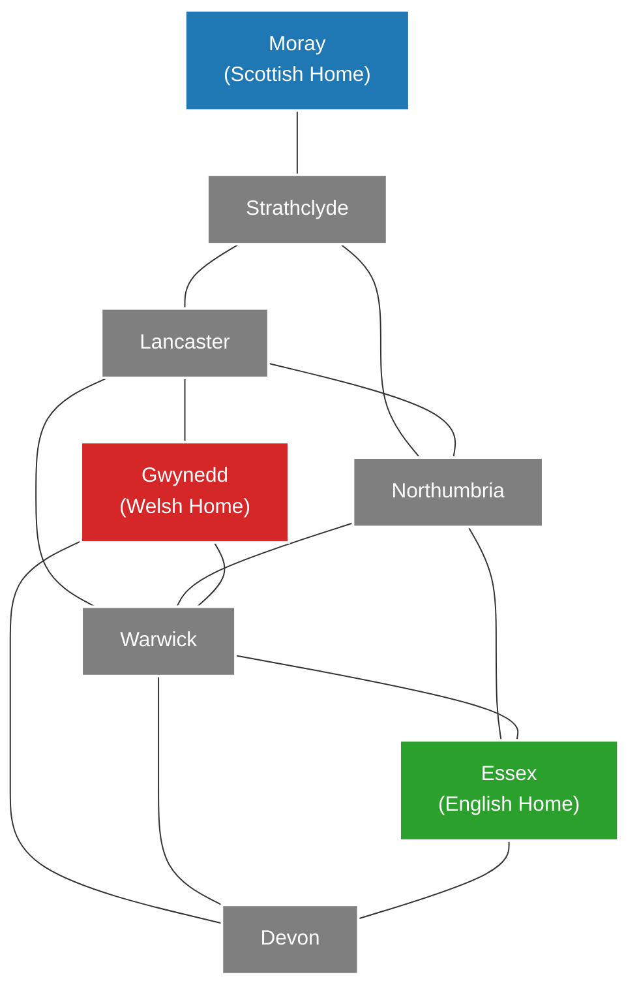

# THE KING IS DEAD

**Second Edition**
_Game Design by Peer Sylvester_
_Illustration by Benoit Billion_

---

## Introduction & Lore

The king is dead. The kingdom is divided. Three factions — the Scottish, the Welsh, and the English — vie for control, all too evenly matched to seize it for themselves. As instability builds and foreign invaders loom, Britain is desperate for a ruler. But who should bear that mantle?

You are nobles and powerbrokers, commanding leaders and conniving schemers, intent on claiming the throne. Without the backing to take control for yourself, you will need to gain support from the factions so they may elevate you to ultimate power. You can gently guide the conflicts so your preferred faction ends up on top, but it would be imprudent to pin all your hopes on just one of them...

The throne is empty and the island is in chaos. Will you rise to the occasion and claim the crown for yourself?

---

## Overview

_The King is Dead_ is a game of political upheaval in medieval Britain. Over the course of the game, you will resolve power struggles in the eight regions of the island to determine which faction will prevail and crown the new monarch. Become the preferred candidate of the victorious faction and the kingdom will be yours!

During the game, you will play action cards to manipulate the balance of power across the board. You will have **only eight cards throughout the entire game**, so choosing when to make your play and when to sit tight will be your key to victory. Act too soon and your opponents will unravel your carefully made plans, but wait too long and the fate of the island will already be sealed.

Whenever you take an action, you will **summon a follower to your court**, increasing your influence with one of the factions. Each follower you take will solidify your claim to be that faction's preferred ruler, but will weaken their ability to win power struggles on the board.

Once each region has been claimed, the faction with the most regions takes control, and the player with the most influence in that faction wins.

---

## Game Components

- **54 Follower Cubes**
  - 18 Scottish Followers (Blue)
  - 18 Welsh Followers (Red)
  - 18 English Followers (Yellow)
- **24 Control Discs**
  - 8 Scottish Control Discs (Blue)
  - 8 Welsh Control Discs (Red)
  - 8 English Control Discs (Yellow)
- **3 Instability Discs** (Black)
- **4 Negotiation Discs** (White)
- **1 Victory Card** (Double-sided: _Coronation_ / _Invasion_)
- **8 Region Cards** (_Moray, Strathclyde, Gwynedd, Lancaster, Northumbria, Warwick, Essex, Devon_)
- **32 Standard Action Cards** (4 identical sets of 8 cards)
- **12 Cunning Action Cards** (Used for the Advanced Game)
- **1 Game Board**

---

## Board Layout Overview

The game board features four main areas:

1. **Regions of Britain:** Eight interconnected regions (_Moray, Strathclyde, Gwynedd, Lancaster, Northumbria, Warwick, Essex, Devon_).
2. **France:** A designated space holding the 3 Instability Discs.
3. **Supply:** A space to hold available follower cubes and control discs.
4. **Numbered Spaces (1 through 8):** Spaces around the perimeter of the board where Region Cards are randomly assigned during setup to define the order of Power Struggles.



## Adjacency list

| Region          | Borders                                       | Connections |
| --------------- | --------------------------------------------- | ----------: |
| **Moray**       | Strathclyde                                   |           1 |
| **Strathclyde** | Lancaster, Moray, Northumbria                 |           3 |
| **Lancaster**   | Gwynedd, Northumbria, Strathclyde, Warwick    |           4 |
| **Northumbria** | Essex, Lancaster, Strathclyde, Warwick        |           4 |
| **Gwynedd**     | Devon, Lancaster, Warwick                     |           3 |
| **Warwick**     | Devon, Essex, Gwynedd, Lancaster, Northumbria |           5 |
| **Essex**       | Devon, Northumbria, Warwick                   |           3 |
| **Devon**       | Essex, Gwynedd, Warwick                       |           3 |

---

## Setup

### Standard Setup

1. **Board:** Place the game board in the middle of the table.
2. **Home Regions:** Place initial followers on their historic strongholds:
   - **2 Scottish Followers** in _Moray_
   - **2 Welsh Followers** in _Gwynedd_
   - **2 English Followers** in _Essex_
3. **Followers:**
   - Place all remaining followers into the cloth bag.
   - **Courts:** Randomly give each player **2 followers** from the bag to place in front of them. This is their starting _Court_.
   - **Regions:** Randomly draw followers from the bag and place them in each region until every region contains **exactly 4 followers**. (For _Moray, Gwynedd, and Essex_, this means adding 2 additional random followers to the 2 home followers already placed there).
   - Place all remaining followers from the bag into the board's **Supply**. Return the cloth bag to the box.
4. **Discs:**
   - Give each player **1 Negotiation Disc**.
   - Place all Control Discs in the Supply.
   - Place all 3 Instability Discs in France.
5. **Cards:**
   - Deal each player a standard hand of **8 Action Cards**:
     - 1× Scottish Support
     - 1× Welsh Support
     - 1× English Support
     - 1× Negotiate
     - 1× Manoeuvre
     - 1× Outmanoeuvre
     - 2× Assemble
   - Do not use the Cunning Action cards in the standard game.
6. **Region Order:** Shuffle the 8 Region Cards and deal one face-up next to each numbered space (1–8) on the board.
7. **Victory Card:** Place the Victory Card near the board where it is easily accessible.
8. **Start Player:** Choose the starting player randomly.

### Two-Player Setup Adjustment

If playing a two-player game, before starting setup, **return 2 followers of each faction (6 cubes total) to the box**. Proceed with standard setup as normal.

### Advanced Game Setup

If all players are familiar with the game and agree, you can play the **Advanced Game**:

- Remove each player's _Scottish Support_, _Welsh Support_, and _English Support_ cards and return them to the box.
- Shuffle the **12 Cunning Action Cards** and secretly deal each player **3 cards**.
- Return any unused Cunning Action Cards to the box without looking at them. Each player starts with an 8-card hand consisting of: _Negotiate, Manoeuvre, Outmanoeuvre, 2× Assemble,_ and _3 unique Cunning Action cards_.

---

## How to Play

### Turn Structure

Beginning with the start player and moving clockwise, players take turns taking either an **Action** or **Passing**. Play continues around the table until the game ends, periodically interrupted by **Power Struggles**.

- **Taking an Action:** Play a card from your hand face-up onto your discard pile, resolve its effect, and then **summon a follower to your court**.
- **Passing:** Forfeit your turn for the current round. When play comes back to you, you may choose to take an action or pass again. Passing on one round does **not** lock you out of future turns.

### Power Struggles

When **all players pass in sequence**, a Power Struggle occurs immediately:

1. **Identify the Contested Region:** Look at the lowest-numbered space (1 through 8) that still has a face-up Region Card.
2. **Determine Control:**
   - Count the followers in that region. The faction with the **strict majority** of followers gains control.
   - Place a Control Disc of that faction into the region.
   - Return all followers from that region to the Supply.
3. **Instability (Ties or Empty Regions):**
   - If two or more factions tie for the most followers, or if there are no followers in the region, the region becomes **Unstable**.
   - Place an **Instability Disc** (from France) in the region.
   - Return all remaining followers from that region to the Supply.
   - _If 3 Instability Discs are placed on the board, the game ends immediately in a French Invasion._
4. **Conclude Struggle:** Flip the resolved Region Card face-down. The next player in turn order takes their turn as normal.

---

## Rules for Taking Actions

### Controlled vs. Uncontrolled Regions

- Once a region has resolved its Power Struggle and has a Control Disc or Instability Disc placed on it, it is **Controlled**.
- **You can NEVER place or move followers into Controlled regions.** Their balance of power is locked for the rest of the game.

### Summoning Followers to Court

Immediately after resolving your action card's text, you **must summon one follower to your court**:

- Select **any single follower cube from any uncontrolled region** on the board and place it in front of you.
- You may choose a follower from a region that your action did not involve.
- You **cannot** take a follower from the Supply or from a Controlled region.

### Card Management & Discarding

- After resolving an action, place the card face-up in front of you so only the most recently played card is visible.
- You may examine your own discard pile at any time, but you **cannot** examine other players' discard piles.
- Each card can only be played once. You will take at most 8 actions in an entire game.

### Partial Actions

- You must carry out an action's effect in full if possible.
- If it is impossible to resolve an action in full, resolve as much of it as possible.
- You may play an action card even if you cannot resolve any of its text effects. In all cases, you **must still summon a follower to your court**.

---

## Game End & Victory Conditions

The game ends in one of two ways: a **French Invasion** or a **Coronation**.

```
                           +------------------------+
                           |  GAME END TRIGGERED?   |
                           +-----------+------------+
                                       |
                   +-------------------+-------------------+
                   |                                       |
       3 Instability Discs Placed                 All 8 Regions Resolved
                   |                                       |
                   v                                       v
         +-------------------+                   +-------------------+
         |  FRENCH INVASION  |                   |    CORONATION     |
         +---------+---------+                   +---------+---------+
                   |                                       |
    Most complete sets of followers         Determine most powerful faction
    (1 Scottish + 1 Welsh + 1 English).     (Most regions controlled; tiebreak:
    Tiebreaker: Last to play an action.     last region won).
                                                           |
                                            Player with most followers of
                                            that top faction wins.
                                            Tiebreaker 1: Most #2 faction.
                                            Tiebreaker 2: First to play 8 cards.
```

### 1. French Invasion

- **Trigger:** Placed when 3 Instability Discs are on the board. The game ends **immediately**.
- **Victory Condition:** The winner is the player (or team) with the highest number of **complete sets of followers** in their court.
  - A _complete set_ consists of **1 Scottish + 1 Welsh + 1 English** follower.
- **Tiebreaker:** The tied player who **most recently played an action card** wins.

### 2. Coronation

- **Trigger:** Resolved when all 8 regions have completed their Power Struggles without triggering an Invasion.
- **Determine Faction Power Ranking:**
  1. Count the number of controlled regions for each faction. The faction with the **highest number of controlled regions** is the most powerful (#1).
  2. If two factions tie for controlled regions, the faction that **won a power struggle most recently** (indicated by the highest-numbered face-down region card) is ranked higher.
- **Victory Condition:** The player with the **most followers of the #1 Most Powerful Faction** in their court wins.
- **Coronation Tiebreakers:**
  1. **Second Most Powerful Faction:** The tied player with the most followers of the 2nd most powerful faction in court wins.
  2. **Decisive Action:** The player who **first played all of their action cards** (emptied their hand first) wins.

---

## Standard Action Cards Reference

### Scottish Support

> _Place two Scottish followers from the supply into a region that borders a region controlled by the Scots._
>
> _If there is no control or instability disc in Moray, you may instead place the followers into a region bordering Moray._

- Both followers must be placed into the same region.
- If fewer than two Scottish followers remain in the supply, place as many as available.

### Welsh Support

> _Place two Welsh followers from the supply into a region that borders a region controlled by the Welsh._
>
> _If there is no control or instability disc in Gwynedd, you may instead place the followers into a region bordering Gwynedd._

- Both followers must be placed into the same region.
- If fewer than two Welsh followers remain in the supply, place as many as available.

### English Support

> _Place two English followers from the supply into a region that borders a region controlled by the English._
>
> _If there is no control or instability disc in Essex, you may instead place the followers into a region bordering Essex._

- Both followers must be placed into the same region.
- If fewer than two English followers remain in the supply, place as many as available.

### Assemble

> _Place a Scottish follower, a Welsh follower, and an English follower from the supply into any region or regions._

- You may place the three followers all into the same region or split them across different uncontrolled regions.
- If the supply lacks followers of a particular faction, skip placing that faction and place the rest.

### Negotiate

> _Swap the positions of any two face-up region cards. Place a negotiation disc on one of the cards you swapped._

- You **cannot** swap region cards that are face-down or already have a negotiation disc on them.
- If fewer than two eligible region cards remain, this card has no effect.

### Manoeuvre

> _Swap a follower in any region with a follower in any other region._

- You may swap followers of the same faction (this has no board effect, but allows you to take an action and summon a follower).
- If a valid swap can be made, you **must** make one.
- **Anti-Undo Rule:** You cannot use a Manoeuvre action to directly undo a Manoeuvre action taken by the player immediately before you, unless at least one other action has taken place in between.

### Outmanoeuvre

> _Swap a follower in any region with two followers in a bordering region._

- You may swap followers of the same faction.
- If a 1-for-2 swap can be made in full, you **must** do so. If not, you must swap 1 follower with 1 single follower in a bordering region.
- **Anti-Undo Rule:** You cannot use an Outmanoeuvre action to directly undo an Outmanoeuvre action taken by the player immediately before you, unless at least one other action has taken place in between.

---

## Cunning Action Cards Reference (Advanced Game Only)

### Spy

> _Resolve the effect of an action card that is face up on top of another player's discard pile._

- Counts as an exact copy of the targeted top discard card. Normal partial action rules apply.

### Ambush

> _Place two Scottish followers from the supply into a region, then return a follower from that region to the supply._

- All effects must occur in the exact same region.
- The follower returned to the supply may be one of the two just placed.
- If fewer than two Scottish followers are in the supply, place as many as available.

### March

> _Move two followers from a single region to a single bordering region._

- Both followers must move to the same destination region.
- If moving two followers is impossible, you must move one follower if able.

### Plot

> _You cannot take this action during the game._

- **Effect:** You do not play this card during standard turns. Keep it in hand. When determining the winner at game end, reveal this card: it counts as **1 additional follower of a faction of your choice**.
- **Coronation Tiebreaker Override:** If the game ends in a Coronation and you are tied for support among the top two factions, having Plot in hand causes you to **win the tiebreaker automatically** (superseding the normal "first to play all cards" tiebreaker).

### Aid

> _Find the faction with the most followers in the supply. Place two followers of that faction into any single region._

- Both followers must be placed into the same region.
- If two or more factions tie for the most followers in the supply, choose one of those tied factions.

### Influence

> _Swap one English follower in any region with two non-English followers in another region._

- The two non-English followers can belong to the same or different factions.
- Must perform full 1-for-2 swap if possible. If not, swap 1 English with 1 non-English follower.

### Dispute

> _Swap a Welsh follower in any region with a non-Welsh follower in another region._

- Must execute if at least one valid swap combination exists on the board.

### Edict

> _Swap two Scottish followers in any region with two non-Scottish followers in a bordering region._

- Non-Scottish followers can belong to the same or different factions.
- Must do 2-for-2 if possible. If not, do 2-for-1 or 1-for-2. If still not possible, do 1-for-1.

### Resist

> _Place two non-Scottish followers from the supply into any region that borders a region controlled by the Scots._
>
> _If there is no control or instability disc in Moray, you may instead place the followers into a region bordering Moray._

- Both followers must be placed into the same region (can be same or different factions).

### Quell

> _Return a Welsh follower to the supply from any region that borders a region controlled by the Welsh. Then place two followers from the supply into that region._
>
> _If there is no control or instability disc in Gwynedd, you may instead carry out this action in a region bordering Gwynedd._

- Place both followers in the region the Welsh follower was removed from.
- If no Welsh follower is available in an eligible region, simply place 2 followers from supply into an eligible region.

### Suppress

> _Return an English follower to the supply from any region that borders a region controlled by the English. Then return another follower to the supply from that region. Then place a follower from the supply into that region._
>
> _If there is no control or instability disc in Essex, you may instead carry out this action in a region bordering Essex._

- If no English follower is present in an eligible region, return any single follower and place 1 from supply. If no followers are present in the region at all, simply add 1 follower from supply.

### Muster

> _Return a Scottish follower to the supply from any region that borders a region controlled by the Scots. Then place two followers from the supply into that region._
>
> _If there is no control or instability disc in Moray, you may instead carry out this action in a region bordering Moray._

- Place both followers in the region the Scottish follower was removed from.
- If no Scottish follower is in an eligible region, simply place 2 followers from supply into an eligible region.

---

## Credits

- **Game Design:** Peer Sylvester
- **Illustration:** Benoit Billion
- **Game Development:** Filip Falk Hartelius & Anthony Howgego
- **Graphic Design:** Steven Meyer-Rassow
- **Publisher:** Osprey Games (Bloomsbury Publishing Plc)

```

The Markdown rulebook has been constructed with all instructions, setup requirements, variant rules, card actions, and edge cases preserved.
```
